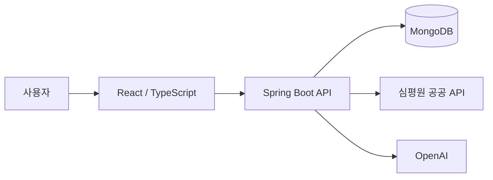

# AI 기반 병원 예약 지원 서비스

**백엔드실습 · 기말프로젝트** — 박다윗 · 김도형 2인 팀

증상과 희망 지역으로 진료과·병원 정보를 확인하고, 샘플 의료진의 일정으로 모의 예약을 진행하는 웹 서비스를 만듭니다.

> 현재 상태: 저장소와 협업 환경 준비 단계입니다. 서비스 구현·실제 배포는 아직 완료되지 않았습니다. 노션의 2026-11-20 수정안 v1.1을 기획 기준으로 사용합니다.

[노션 프로젝트](https://app.notion.com/p/050b8822a70f83c0bdcf81cbf0090447) · [협업 규칙](CONTRIBUTING.md) · [브랜치 안내](docs/branch-strategy.md) · [진행 현황](docs/progress-and-next.md)

## 목차

1. [프로젝트 설명](#1-프로젝트-설명)
2. [주제 선택 이유](#2-주제-선택-이유)
3. [주요 기능](#3-주요-기능)
4. [기술 스택과 구조](#4-기술-스택과-구조)
5. [계획서와 발표자료](#5-계획서와-발표자료)
6. [시연 동영상](#6-시연-동영상)
7. [팀원 소개](#7-팀원-소개)
8. [배포 URL](#8-배포-url)
9. [폴더와 시작 방법](#9-폴더와-시작-방법)
10. [협업 규칙](#10-협업-규칙)

## 1. 프로젝트 설명

사용자는 AI 상담 또는 직접 검색으로 병원을 찾고, 정보의 출처를 확인한 다음 날짜·시간을 선택합니다. 로그인과 최종 확인을 거쳐 모의 예약을 저장하며, 마이페이지에서 변경·취소합니다.

실제 병원 정보와 샘플 의료진·시간표를 구분합니다. 실제 진단·처방·병원 접수는 제공하지 않습니다. 초기 검증 지역은 수원시 영통구를 제안하며 최종 범위는 팀 회의에서 확정합니다.

## 2. 주제 선택 이유

병원명이나 진료과를 먼저 알아야 하는 검색 방식은 디지털 예약이 익숙하지 않은 사용자에게 어렵습니다. 평소 말하듯 조건을 입력하고 한 번에 하나씩 선택하는 흐름으로 검색부터 예약 확인까지 연결하려 합니다.

## 3. 주요 기능

| 구분 | 내용 |
| --- | --- |
| 필수 | 회원가입·로그인, 병원 검색·상세, AI 조건 추출·추가 질문, 정보 출처 표시 |
| 필수 | 샘플 의료진·일정, 모의 예약·변경·취소, 관리자 일정 관리 |
| 핵심 검증 | 동시 예약 정원, 중복 요청, 예약 소유자 확인, 변경·취소 정합성 |
| 선택 | 병원평가 정보, NMC 진료요일 보완, 상담 이력, 이메일 알림 |
| 범위 밖 | 실제 병원 접수, 진단·처방, 결제, 실시간 대기열, 지도 경로, 모바일 앱 |

## 4. 기술 스택과 구조

| 분야 | 현재 기획 기준 |
| --- | --- |
| Frontend | React · TypeScript · Vite |
| Backend | Java 21 · Spring Boot · Spring Security · Spring Data MongoDB |
| Database | MongoDB Atlas, 트랜잭션 가능한 replica set |
| AI / 외부 API | OpenAI · 심평원 병원정보/의료기관별상세정보 |
| 배포 | Vercel(FE), Render(BE 후보, 미확정) |
| 협업 | GitHub Issues·PR · Notion |

라이브러리 버전은 초기 설정 PR에서 호환성을 확인한 뒤 고정합니다. 이전 기획서의 MySQL·JPA·RDS·Flyway 구성은 현재 기준이 아닙니다.



상세 설계는 [아키텍처](docs/architecture.md), [API 계약](docs/api-contract.md), [DB 설계](docs/database.md)를 함께 갱신합니다.

## 5. 계획서와 발표자료

| 자료 | 위치 |
| --- | --- |
| 원본 기획 | [노션 서비스 기획과 범위 v1.1](https://app.notion.com/p/879b8822a70f82f789298129ce73194d) |
| 저장소 계획서 | [docs/project-plan.md](docs/project-plan.md) |
| 발표자료 | [docs/presentation/](docs/presentation/README.md), 작성 예정 |
| 제출 점검 | [docs/submission-checklist.md](docs/submission-checklist.md) |

## 6. 시연 동영상

영상 URL은 미정입니다. [시연 시나리오](docs/demo-script.md)를 기준으로 구현 완료 후 촬영합니다.

## 7. 팀원 소개

| 이름 | GitHub | 담당 |
| --- | --- | --- |
| 박다윗 | [DavidPark04](https://github.com/DavidPark04) | 상세 역할 미정, Issue 담당자로 작업 단위 배정 |
| 김도형 | [kdh0381](https://github.com/kdh0381) | 상세 역할 미정, Issue 담당자로 작업 단위 배정 |

두 사람이 상대의 PR을 검토합니다. FE/BE 주 담당이 정해져도 API 계약·DB 구조·배포 설정 변경은 함께 확인합니다.

## 8. 배포 URL

프론트엔드·백엔드·API 문서 주소는 모두 미정입니다. [배포 안내](infra/README.md)에 실제 검증 결과와 함께 등록합니다.

## 9. 폴더와 시작 방법

```text
hospital-reservation/
├── .github/             # PR·Issue 템플릿, 저장소 검사 CI
├── backend/             # Spring Boot 소스·테스트 자리
├── frontend/            # React 소스·테스트 자리
├── docs/                # 계획서, API·DB 설계, 발표·시연·제출 자료
├── infra/               # 배포 구성과 운영 안내
├── scripts/             # 저장소 검사 도구
├── CONTRIBUTING.md      # 두 사람의 협업 규칙
└── README.md
```

```bash
git clone https://github.com/DavidPark04/hospital-reservation.git
cd hospital-reservation
git switch develop
git pull --ff-only origin develop
python3 scripts/check_repository.py
```

현재는 저장소 구조만 준비되어 있어 앱 실행 명령은 없습니다. [BE 시작 작업](backend/README.md)과 [FE 시작 작업](frontend/README.md)에서 프로젝트를 초기화한 뒤, 실행·테스트 명령과 환경변수 연결을 같은 PR에 추가합니다.

## 10. 협업 규칙

- `main`: 제출·배포 기준. `develop`: 개발 통합. 두 브랜치에 직접 push하지 않습니다.
- 작업마다 `develop`에서 브랜치를 만들고, FE·BE·공통 작업을 이름으로 구분합니다.
- 상대 팀원 1명 승인, 검사 통과, 리뷰 의견 해결 후 병합합니다.
- 작업 PR → `develop`은 **Squash and merge**, `develop` → `main`은 **Create a merge commit**입니다.
- 커밋·PR 제목은 `feat: 모의 예약 생성`처럼 `종류: 한국어 설명`으로 씁니다.
- 비밀 키·DB URI·실제 사용자 데이터는 커밋하지 않습니다.

자세한 예시와 긴급 수정 절차는 [CONTRIBUTING.md](CONTRIBUTING.md), 실제 GitHub 적용 상태는 [저장소 설정 현황](docs/repository-settings.md)을 확인합니다.

구성 참고: [BOKJI-MUNTEOK/bokji-munteok](https://github.com/BOKJI-MUNTEOK/bokji-munteok). 문서 구성과 협업 흐름을 참고했으며, 서비스 코드는 가져오지 않았습니다.
