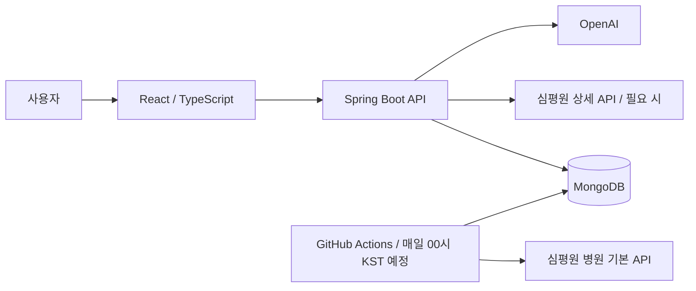

# AI 기반 병원 예약 지원 서비스

**백엔드실습 · 기말프로젝트** — 박다윗 · 김도형 2인 팀

증상과 희망 지역으로 진료과·병원 정보를 확인하고, 샘플 의료진의 일정으로 모의 예약을 진행하는 웹 서비스를 만듭니다.

> 현재 상태: [hospital-reservation-app.vercel.app](https://hospital-reservation-app.vercel.app)에서 React 화면과 Spring API를 운영하며 MongoDB 연결을 확인했습니다. `main`의 앱 검사 통과 후 김도형의 Vercel 프로젝트로 자동 배포하도록 구성했습니다. 전화번호·이메일 중복 차단 수정본은 로컬 테스트 155개와 HTTP 검사 26개를 통과했으며, 버전별 운영 반영은 PR·배포 기록에서 확인합니다. 새 주소의 구글·카카오 실계정 로그인은 사용자 콘솔의 callback 등록 후 확인합니다.

[노션 프로젝트](https://app.notion.com/p/050b8822a70f83c0bdcf81cbf0090447) · [협업 규칙](CONTRIBUTING.md) · [브랜치 안내](docs/branch-strategy.md) · [진행 현황](docs/progress-and-next.md)

## 목차

1. [프로젝트 설명](#1-프로젝트-설명)
2. [주제 선택 이유](#2-주제-선택-이유)
3. [주요 기능](#3-주요-기능)
4. [기술 스택과 구조](#4-기술-스택과-구조)
5. [계획서와 발표자료](#5-계획서와-발표자료)
6. [시연 동영상](#6-시연-동영상)
7. [팀원 소개](#7-팀원-소개)
8. [배포 URL](#8-배포-url)
9. [폴더와 시작 방법](#9-폴더와-시작-방법)
10. [협업 규칙](#10-협업-규칙)

## 1. 프로젝트 설명

사용자는 AI 상담 또는 직접 검색으로 병원을 찾고, 정보의 출처를 확인한 다음 날짜·시간을 선택합니다. 로그인과 최종 확인을 거쳐 모의 예약을 저장하며, 마이페이지에서 변경·취소합니다.

실제 병원 정보와 샘플 의료진·시간표를 구분합니다. 실제 진단·처방·병원 접수는 제공하지 않습니다. 병원 기본 목록은 전국 자료를 MongoDB에 사전 수집하도록 구성하며, 웹 검색은 저장된 목록만 조회합니다. 초기 적재와 매일 갱신의 실제 성공 여부는 동기화 실행 기록에서 확인합니다.

## 2. 주제 선택 이유

병원명이나 진료과를 먼저 알아야 하는 검색 방식은 디지털 예약이 익숙하지 않은 사용자에게 어렵습니다. 평소 말하듯 조건을 입력하고 한 번에 하나씩 선택하는 흐름으로 검색부터 예약 확인까지 연결하려 합니다.

## 3. 주요 기능

| 구분 | 내용 |
| --- | --- |
| 구현 | 아이디 회원가입·로그인·로그아웃, 구글/카카오 로그인, 추가 가입 정보 입력, 마이페이지·비밀번호 변경·회원 탈퇴 |
| 구현 | 병원 검색·상세·진료과, AI 조건 추출·추가 질문, 정보 출처·조회 시점 표시 |
| 구현 | MongoDB 병원 기본 목록 검색, 매일 한국 시간 자정 예정 수집과 변경분 동기화 |
| 구현 | 병원 상세의 카카오 지도·위치 표시, 카카오맵 길찾기·검색 연결 (지도 키·도메인 설정 필요) |
| 구현 | 저장된 가상 의료진·일정, 모의 예약·변경·취소, 관리자 일정·정원·휴진 관리 |
| 구현 | 관리자 회원 목록·가입 방식 표시·회원 삭제, 전화번호 또는 이메일 중복 가입 차단 |
| 핵심 검증 | 동시 예약 정원, 중복 요청, 예약 소유자 확인, 변경·취소 정합성 |
| 미구현·추후 검토 | 병원평가 정보, NMC 진료요일 보완, 동의·보관 기간을 검토한 상담 이력, 이메일 알림, 전체 예약 관리 도구 |
| 범위 밖 | 실제 병원 접수, 진단·처방, 결제, 실시간 대기열, 사이트 내부 경로 계산·내비게이션, 모바일 앱 |

## 4. 기술 스택과 구조

| 분야 | 현재 기획 기준 |
| --- | --- |
| Frontend | React · TypeScript · Vite · TanStack Query |
| Backend | Java 21 · Spring Boot 3 · Spring Security · Spring Data MongoDB · WebClient |
| Database | MongoDB Atlas, 트랜잭션 가능한 replica set |
| AI / 외부 API | OpenAI · 심평원 병원정보/의료기관별상세정보 · 카카오 지도 Web SDK |
| 배포 | Vercel Services: Vite FE + Java 21 Container BE, MongoDB Atlas |
| 협업 | GitHub Issues·PR · Notion |

Gradle Wrapper·npm lockfile을 포함합니다. 기획서의 초기 PoC, 이번 코드의 자동 테스트, 실제 외부 API·배포 검증은 별도 증거로 관리합니다. 배포는 Vercel을 사용하며 API 키 등 운영 환경변수는 프로젝트 소유자가 관리합니다.



상세 설계는 [아키텍처](docs/architecture.md), [API 계약](docs/api-contract.md), [DB 설계](docs/database.md)를 함께 갱신합니다. 전국 기본 목록 수집·DB 적용·재실행 방법은 [병원 목록 운영 안내](docs/hospital-catalog.md)를 참고합니다.

## 5. 계획서와 발표자료

| 자료 | 위치 |
| --- | --- |
| 기준 기획서 | [노션 서비스 기획과 범위 및 첨부 PDF](https://app.notion.com/p/879b8822a70f82f789298129ce73194d) |
| 저장소 계획서 | [docs/project-plan.md](docs/project-plan.md) |
| 발표자료 | [docs/presentation/](docs/presentation/README.md), 작성 예정 |
| 제출 점검 | [docs/submission-checklist.md](docs/submission-checklist.md) |

2026년 **11/20~12/9의 4주 계획**으로 진행합니다. 1주차 준비 → 2주차 핵심 구현 → 3주차 통합·배포·검증 → 4주차 보고서·시연 준비 순서입니다. **12/2 기능 동결, 12/5 통합 검증, 12/8 준비 완료, 12/9 기말고사**를 기준으로 하며 과제 제출 시각은 별도 확인합니다. 주차별 산출물은 [프로젝트 계획서](docs/project-plan.md)에 정리합니다.

## 6. 시연 동영상

영상 URL은 미정입니다. [시연 시나리오](docs/demo-script.md)를 기준으로 구현 완료 후 촬영합니다.

## 7. 팀원 소개

| 이름 | GitHub | 담당 |
| --- | --- | --- |
| 박다윗 | [DavidPark04](https://github.com/DavidPark04) | 상세 역할 미정, Issue 담당자로 작업 단위 배정 |
| 김도형 | [kdh0381](https://github.com/kdh0381) | 상세 역할 미정, Issue 담당자로 작업 단위 배정 |

필요한 PR에 상대의 검토를 요청할 수 있습니다. FE/BE 주 담당이 정해져도 API 계약·DB 구조·배포 설정 변경은 문서와 PR에 공유합니다. 상대 승인은 병합 필수 조건이 아닙니다.

## 8. 배포 URL

새 운영 대상은 [hospital-reservation-app.vercel.app](https://hospital-reservation-app.vercel.app)입니다. GitHub 저장소는 `DavidPark04/hospital-reservation`을 유지하고, 김도형의 Vercel 프로젝트에서 React 화면과 Spring API를 함께 운영합니다. 자동 배포에 필요한 설정과 접속 확인 방법은 [배포 안내](infra/README.md)를 확인합니다.

## 9. 폴더와 시작 방법

```text
hospital-reservation/
├── .github/             # PR·Issue 템플릿, 저장소·앱 검사 CI
├── backend/             # Spring Boot 소스·MongoDB 통합 테스트
├── frontend/            # React·TypeScript 앱
├── docs/                # 계획서, API·DB 설계, 발표·시연·제출 자료
├── infra/               # 배포 구성과 운영 안내
├── scripts/             # 저장소 검사 도구
├── CONTRIBUTING.md      # 두 사람의 협업 규칙
└── README.md
```

```bash
git clone https://github.com/DavidPark04/hospital-reservation.git
cd hospital-reservation
git switch develop
git pull --ff-only origin develop
python3 scripts/check_repository.py
```

Java 21과 Node.js 22를 준비한 뒤 루트와 `frontend`에서 각각 `npm ci`를 실행합니다. 루트 `.env.example`을 참고해 로컬 환경변수를 설정하고 백엔드를 빌드합니다. Windows 통합 실행은 `start.cmd`, 개별 실행·검증은 [Backend](backend/README.md)와 [Frontend](frontend/README.md)를 따릅니다. 기본 화면은 `http://127.0.0.1:5174`, API는 `http://127.0.0.1:18081`입니다.

웹 접속·검색·AI 추천은 병원 기본 API를 호출하지 않습니다. 기본 자료는 `hospitalBasicCatalog`에서 읽고, 병원을 선택한 뒤 필요한 진료과·특수진료·전문병원 지정 상세 3종은 기존처럼 조회하여 1시간 캐시합니다. 자정 동기화는 GitHub Actions에서 기본 API만 수집하며 Vercel을 매일 재배포하지 않습니다. 병원 기본 자료가 준비되지 않은 로컬 DB는 [초기 적재 절차](docs/hospital-catalog.md)를 먼저 실행합니다.

병원 상세 지도는 `VITE_KAKAO_MAP_JS_KEY`에 카카오의 **JavaScript 키**를 설정하고 카카오맵 사용 설정·SDK 도메인을 등록해야 표시됩니다. HIRA 좌표를 우선 사용하고, 좌표가 없으면 병원 주소로 위치를 확인합니다. 위치를 확정할 수 없으면 임의의 지점을 표시하지 않고 카카오맵 검색 링크를 제공합니다. 가상 샘플 병원은 지도·길찾기에서 제외하며 현재 위치를 수집하지 않습니다. 길찾기는 카카오맵 화면으로 연결합니다. 설정 방법은 [지도 배포 설정](infra/README.md#카카오-지도-설정)을 참고합니다.

구글·카카오에서는 계정 식별번호만 사용합니다. 일반·소셜 신규 가입 모두 이름·이메일·전화번호를 직접 입력하며 인증 메일·문자를 보내지 않습니다. 가입 방식과 이름에 관계없이 전화번호 또는 이메일 중 하나라도 기존 회원과 같으면 가입을 막습니다. 기존 가입 방식과 로그인 버튼은 정규화한 이름과 전화번호가 모두 일치할 때만 안내하며, 그 외 중복에는 “이미 가입된 정보가 있어요. 입력 정보를 확인해 주세요.”를 표시합니다. 전화번호는 공백·하이픈을 제거하고 이메일은 앞뒤 공백과 대소문자를 구분하지 않고 비교합니다. 이는 입력값 중복 검사이며 본인 인증이나 계정 자동 통합을 의미하지 않습니다. 가입 완료 전에는 정식 회원 목록에 등록하지 않으며 기존 회원의 누락된 이메일을 임의로 채우지 않습니다.

일반·소셜 가입의 전화번호 입력에는 하이픈을 자동 표시합니다. 휴대전화는 `010-1234-5678`처럼 보이며, 전송·저장·중복 비교에는 기존의 숫자 형식을 사용합니다. 지역번호가 있는 국내 전화번호도 입력할 수 있습니다.

일반 로그인 회원과 관리자는 마이페이지에서 현재 비밀번호를 확인한 뒤 새 비밀번호와 확인값을 입력해 변경합니다. 변경 후 현재 화면의 로그인은 새 토큰으로 유지되고 이전 로그인 토큰은 무효화됩니다. 구글·카카오 회원의 비밀번호는 해당 제공자에서 관리하며 이 서비스에서 별도 비밀번호를 만들지 않습니다.

마이페이지에서 일반 회원은 현재 비밀번호를 확인하고 탈퇴합니다. 구글·카카오 회원은 가입한 소셜 계정을 다시 확인한 뒤 최종 탈퇴 버튼을 누릅니다. 다른 소셜 계정을 선택하거나 인증을 취소하면 탈퇴하지 않습니다. 회원정보 삭제·활성 예약 취소·예약 정원 반환은 한 트랜잭션으로 처리하며, 탈퇴 후 기존 로그인 토큰은 사용할 수 없습니다. 예약·이벤트의 UUID 기반 이력은 보존하고 관리자 계정은 탈퇴 대상에서 제외합니다. 소셜 계정 확인은 기존 로그인 콜백 주소를 사용하므로 운영 도메인이 바뀌면 제공자 콘솔에도 해당 주소를 등록해야 합니다.

## 10. 협업 규칙

- `main`: 제출·배포 기준. `develop`: 개발 통합. 두 브랜치에 직접 push하지 않습니다.
- 작업마다 `develop`에서 브랜치를 만들고, FE·BE·공통 작업을 이름으로 구분합니다.
- 상대 승인 없이 검사 통과·리뷰 대화 해결 후 작성자가 병합할 수 있습니다.
- 작업 PR → `develop`은 **Squash and merge**, `develop` → `main`은 **Create a merge commit**입니다.
- 커밋·PR 제목은 `feat: 모의 예약 생성`처럼 `종류: 한국어 설명`으로 씁니다.
- 비밀 키·DB URI·실제 사용자 데이터는 커밋하지 않습니다.

자세한 예시와 긴급 수정 절차는 [CONTRIBUTING.md](CONTRIBUTING.md), 실제 GitHub 적용 상태는 [저장소 설정 현황](docs/repository-settings.md)을 확인합니다.

구성 참고: [BOKJI-MUNTEOK/bokji-munteok](https://github.com/BOKJI-MUNTEOK/bokji-munteok). 문서 구성과 협업 흐름을 참고했으며, 서비스 코드는 가져오지 않았습니다.
