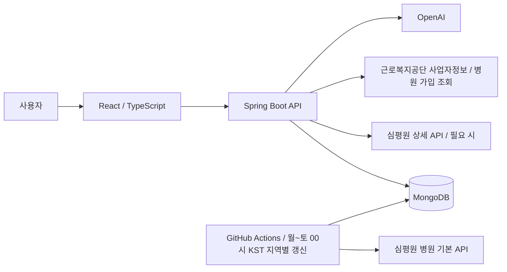

# 메디픽 · AI 기반 병원 예약 지원 서비스

**백엔드실습 · 기말프로젝트** — 박다윗 · 김도형 2인 팀

메디픽은 증상과 진료 목적에 따라 서비스에 등록한 병·의원이나 전문 진료기관을 찾고, 추천 이유와 출처를 확인한 뒤 병원이 직접 등록한 의료진·일정으로 예약하는 수업용 서비스입니다.

> 홈을 스크롤하며 상담, 추천 근거, 병원 위치, 등록된 의료진과 예약 시간을 살펴볼 수 있습니다. 병원 찾기와 AI 상담은 상단 메뉴에서도 바로 열립니다. [메디픽 열기](https://medi-pick.vercel.app)

[노션 프로젝트](https://app.notion.com/p/050b8822a70f83c0bdcf81cbf0090447) · [협업 규칙](CONTRIBUTING.md) · [브랜치 안내](docs/branch-strategy.md) · [진행 현황](docs/progress-and-next.md)

## 목차

1. [프로젝트 설명](#1-프로젝트-설명)
2. [주제 선택 이유](#2-주제-선택-이유)
3. [주요 기능](#3-주요-기능)
4. [기술 스택과 구조](#4-기술-스택과-구조)
5. [계획서와 발표자료](#5-계획서와-발표자료)
6. [시연 동영상](#6-시연-동영상)
7. [팀원 소개](#7-팀원-소개)
8. [배포 URL](#8-배포-url)
9. [폴더와 시작 방법](#9-폴더와-시작-방법)
10. [협업 규칙](#10-협업-규칙)

## 1. 프로젝트 설명

사용자는 AI 상담 또는 직접 검색으로 병원을 찾고, 정보의 출처를 확인한 다음 날짜·시간을 선택합니다. 로그인과 최종 확인을 거쳐 모의 예약을 저장하며, 마이페이지에서 변경·취소합니다.

병원 기본 목록은 전국 자료를 MongoDB에 보관하고, 웹 검색·추천·상세·신규 예약에는 메디픽에 가입한 병원만 표시합니다. 병원은 의료진·진료과·시간·정원을 직접 설정하고 자기 병원의 예약을 관리합니다. 개인 회원은 이메일·문자 인증을 거쳐 가입하고 마이페이지에서 정보를 관리합니다. 실제 진단·처방이나 외부 병원 접수 시스템(HIS) 연동은 제공하지 않으며, 앱의 예약 저장은 실제 병원 접수 완료를 뜻하지 않습니다. 기본 목록은 월~토 한국 시간 00시에 요일별 지역을 나누어 갱신하며, 실제 성공 여부는 동기화 실행 기록에서 확인합니다.

## 2. 주제 선택 이유

병원명이나 진료과를 먼저 알아야 하는 검색 방식은 디지털 예약이 익숙하지 않은 사용자에게 어렵습니다. 평소 말하듯 조건을 입력하고 한 번에 하나씩 선택하는 흐름으로 검색부터 예약 확인까지 연결하려 합니다.

## 3. 주요 기능

| 구분 | 내용 |
| --- | --- |
| 구현 | 아이디·구글/카카오 가입과 로그인, 개인 가입 이메일·문자 인증, 인증 후 연락처 잠금, 마이페이지·이메일 변경·비밀번호 변경/찾기·회원 탈퇴 |
| 구현 | 개인/병원 가입·로그인 구분, 사업자번호로 병원 조회·기본정보 자동 입력, 사업자번호·비밀번호 병원 로그인 |
| 구현 | 등록 병원 검색·상세·진료과, 대화형 진료 목적·선호 확인, 등록 병원 중 주변 병·의원 및 웹 근거 기반 전문 진료기관 추천 |
| 구현 | MongoDB 전체 병원 기본 목록 보관, 등록 병원 공개 필터, 월~토 한국 시간 자정에 요일별 지역 수집과 변경분 동기화 |
| 구현 | 병원 상세의 카카오 지도·위치 표시, 카카오맵 길찾기·검색 연결 (지도 키·도메인 설정 필요) |
| 구현 | 병원이 직접 의료진·진료과·예약 시간·정원 등록 및 수정, 자기 병원 예약 조회·변경·취소, 서버 소속 검사 |
| 구현 | 관리자 개인/병원 회원 목록 분리·병원 회원 삭제, 전화번호 또는 이메일 중복 가입 차단, 문자 인증 직후 기존 가입 방식 안내 |
| 핵심 검증 | 동시 예약 정원, 중복 요청, 개인 예약 소유자와 병원 소속 확인, 기본정보 수정 차단, 변경·취소 정합성 |
| 미구현·추후 검토 | 병원평가 정보, NMC 진료요일 보완, 동의·보관 기간을 검토한 상담 이력, 이메일 알림, 전체 예약 관리 도구 |
| 범위 밖 | 실제 병원 접수, 진단·처방, 결제, 실시간 대기열, 사이트 내부 경로 계산·내비게이션, 모바일 앱 |

병원 기본 목록은 다음 일정으로 지역마다 주 1회 갱신합니다. 실행 예정 시각은 모두 **한국 시간 00:00**이며 일요일은 예약 실행이 없습니다.

| 요일 | 갱신 지역 |
| --- | --- |
| 월 | 서울 |
| 화 | 경기 |
| 수 | 부산·전남광주·경남 |
| 목 | 대구·인천·경북 |
| 금 | 전북·충남·대전 |
| 토 | 충북·강원·울산·제주·세종·광주 별도 코드 |

그날 대상 지역의 기본 목록과 16개 진료과 목록을 모두 검증한 뒤 해당 지역의 변경분만 반영합니다. 다른 지역의 자료는 보존합니다. 500건 페이지로 시작하고 반복되는 API 오류에는 100건으로 나누어 다시 조회합니다. GitHub 예약 실행은 지연될 수 있으며, 지연·재실행되어도 원래 예약된 요일의 지역을 선택합니다. [수집·재실행 안내](docs/hospital-catalog.md)

## 4. 기술 스택과 구조

| 분야 | 현재 기획 기준 |
| --- | --- |
| Frontend | React · TypeScript · Vite · TanStack Query |
| Backend | Java 21 · Spring Boot 3 · Spring Security · Spring Data MongoDB · WebClient |
| Database | MongoDB Atlas의 `MediPick` 데이터베이스, 트랜잭션 가능한 replica set |
| AI / 외부 API | OpenAI · 심평원 병원정보/의료기관별상세정보 · 근로복지공단 고용/산재보험 현황정보 · 카카오 지도 Web SDK · Gmail SMTP · Google Identity Platform 문자 인증 |
| 배포 | Vercel Services: Vite FE + Java 21 Container BE, MongoDB Atlas |
| 협업 | GitHub Issues·PR · Notion |

Gradle Wrapper·npm lockfile을 포함합니다. 기획서의 초기 PoC, 이번 코드의 자동 테스트, 실제 외부 API·배포 검증은 별도 증거로 관리합니다. 배포는 Vercel을 사용하며 API 키 등 운영 환경변수는 프로젝트 소유자가 관리합니다.



상세 설계는 [아키텍처](docs/architecture.md), [API 계약](docs/api-contract.md), [DB 구조와 필드 설명](docs/database.md)를 함께 갱신합니다. 전국 기본 목록 수집·DB 적용·재실행 방법은 [병원 목록 운영 안내](docs/hospital-catalog.md)를 참고합니다.

## 5. 계획서와 발표자료

| 자료 | 위치 |
| --- | --- |
| 기준 기획서 | [노션 서비스 기획과 범위 및 첨부 PDF](https://app.notion.com/p/879b8822a70f82f789298129ce73194d) |
| 저장소 계획서 | [docs/project-plan.md](docs/project-plan.md) |
| 발표자료 | [docs/presentation/](docs/presentation/README.md), 작성 예정 |
| 제출 점검 | [docs/submission-checklist.md](docs/submission-checklist.md) |

2026년 **11/20~12/9의 4주 계획**으로 진행합니다. 1주차 준비 → 2주차 핵심 구현 → 3주차 통합·배포·검증 → 4주차 보고서·시연 준비 순서입니다. **12/2 기능 동결, 12/5 통합 검증, 12/8 준비 완료, 12/9 기말고사**를 기준으로 하며 과제 제출 시각은 별도 확인합니다. 주차별 산출물은 [프로젝트 계획서](docs/project-plan.md)에 정리합니다.

## 6. 시연 동영상

영상 URL은 미정입니다. [시연 시나리오](docs/demo-script.md)를 기준으로 구현 완료 후 촬영합니다.

## 7. 팀원 소개

| 이름 | GitHub | 담당 |
| --- | --- | --- |
| 박다윗 | [DavidPark04](https://github.com/DavidPark04) | 상세 역할 미정, Issue 담당자로 작업 단위 배정 |
| 김도형 | [kdh0381](https://github.com/kdh0381) | 상세 역할 미정, Issue 담당자로 작업 단위 배정 |

필요한 PR에 상대의 검토를 요청할 수 있습니다. FE/BE 주 담당이 정해져도 API 계약·DB 구조·배포 설정 변경은 문서와 PR에 공유합니다. 상대 승인은 병합 필수 조건이 아닙니다.

## 8. 배포 URL

작업 PR 한 개를 `main`에 병합하면 병합된 커밋을 검사합니다. `Repository checks`와 `Application checks`가 모두 성공하면 `Vercel production`이 `develop`을 같은 커밋으로 갱신하고 React 화면과 Spring API를 함께 배포합니다. [운영 사이트](https://medi-pick.vercel.app) · [배포 및 소셜 로그인 주소 설정](infra/README.md)

## 9. 폴더와 시작 방법

```text
hospital-reservation/
├── .github/             # PR·Issue 템플릿, 저장소·앱 검사 CI
├── backend/             # Spring Boot 소스·MongoDB 통합 테스트
├── frontend/            # React·TypeScript 앱
├── docs/                # 계획서, API·DB 설계, 발표·시연·제출 자료
├── infra/               # 배포 구성과 운영 안내
├── scripts/             # 저장소 검사 도구
├── CONTRIBUTING.md      # 두 사람의 협업 규칙
└── README.md
```

```bash
git clone https://github.com/medipick-dev/hospital-reservation.git
cd hospital-reservation
git switch main
git pull --ff-only origin main
python3 scripts/check_repository.py
```

Java 21과 Node.js 22를 준비한 뒤 루트와 `frontend`에서 각각 `npm ci`를 실행합니다. 루트 `.env.example`을 참고해 로컬 환경변수를 설정하고 백엔드를 빌드합니다. Windows 통합 실행은 `start.cmd`, 개별 실행·검증은 [Backend](backend/README.md)와 [Frontend](frontend/README.md)를 따릅니다. 기본 화면은 `http://127.0.0.1:5174`, API는 `http://127.0.0.1:18081`입니다.

웹 접속·검색·AI 추천은 병원 기본 API를 호출하지 않습니다. 기본 자료는 기획서의 병원 컬렉션인 `hospitals`에서 읽고 `hospitalRegistrations`에 활성 등록된 병원만 공개합니다. 병원을 선택한 뒤 필요한 진료과·특수진료·전문병원 지정 상세 3종은 기존처럼 조회하여 `hospitalDetails`에 1시간 캐시합니다. 예약에 쓰는 진료과·의료진·일정은 병원 관리 화면에서 등록합니다. 요일별 자정 동기화는 GitHub Actions에서 기본 API만 수집하며 Vercel 재배포와 별개로 동작합니다. 병원 기본 자료가 준비되지 않은 로컬 DB는 [초기 적재 절차](docs/hospital-catalog.md)를 먼저 실행합니다. 병원 가입 전에는 공개 목록이 비어 있을 수 있습니다.

병원 가입에는 서버 환경변수 `COMWEL_API_KEY`가 필요합니다. 사업자번호로 조회한 사업장명·주소 등을 DB 병원과 대조한 뒤 병원명·주소·우편번호·전화번호를 자동 입력하고 수정을 막습니다. 전화번호가 없으면 빈칸으로 등록합니다. 병원은 이메일과 소셜 가입을 사용하지 않습니다. 이 대조는 공개 병원 정보의 일치 확인이며 신청자의 실제 병원 운영 권한 인증을 의미하지 않습니다.

AI 상담은 증상·진료 목적을 대화로 확인한 뒤 가까운 병·의원 또는 전문 진료기관 중 희망하는 방향을 묻습니다. 명시적으로 위치를 제공하면 직선거리를 비교하며, 전문 진료기관은 웹 근거와 실제 DB의 기관명·주소를 대조합니다. 공개 검색 결과는 24시간 재사용하고 근거 링크·확인 시각을 표시합니다. 증상 원문과 정밀 위치는 저장하지 않습니다. [추천 흐름과 한계](docs/recommendations.md)를 참고하세요.

병원 상세 지도는 `VITE_KAKAO_MAP_JS_KEY`에 카카오의 **JavaScript 키**를 설정하고 카카오맵 사용 설정·SDK 도메인을 등록해야 표시됩니다. HIRA 좌표를 우선 사용하고, 좌표가 없으면 병원 주소로 위치를 확인합니다. 위치를 확정할 수 없으면 임의의 지점을 표시하지 않고 카카오맵 검색 링크를 제공합니다. 가상 샘플 병원은 지도·길찾기에서 제외하며 현재 위치를 수집하지 않습니다. 길찾기는 카카오맵 화면으로 연결합니다. 설정 방법은 [지도 배포 설정](infra/README.md#카카오-지도-설정)을 참고합니다.

구글·카카오에서는 계정 식별번호만 사용합니다. 개인의 일반·소셜 신규 가입 모두 이름·이메일·전화번호를 직접 입력하며 이메일 코드와 문자 코드 인증을 완료해야 합니다. 이메일은 Gmail SMTP, 문자는 Google Identity Platform과 Firebase 웹 SDK를 사용합니다. 인증된 연락처는 같은 잠금 색상으로 표시하고 수정을 막습니다. 가입 방식과 이름에 관계없이 전화번호 또는 이메일 중 하나라도 기존 회원과 같으면 가입을 막습니다. 서버가 가입용 문자 인증을 검증한 뒤 같은 번호의 가입 완료 개인 회원이 있으면 이름과 무관하게 일반·구글·카카오 가입 방식과 로그인 버튼을 즉시 안내합니다. 이메일·이름만으로 가입 방식을 공개하거나 계정을 자동 통합하지 않습니다. 최종 가입 중복 오류에는 공통 안내만 표시합니다. 가입 완료 전에는 정식 회원 목록에 등록하지 않으며 기존 회원의 누락된 이메일을 임의로 채우지 않습니다. [개인 인증 환경 설정](backend/README.md#개인-이메일문자-인증-설정)

일반·소셜 가입의 전화번호 입력에는 하이픈을 자동 표시합니다. 휴대전화는 `010-1234-5678`처럼 보이며, 전송·저장·중복 비교에는 기존의 숫자 형식을 사용합니다. 지역번호가 있는 국내 전화번호도 입력할 수 있습니다.

개인 일반 로그인 회원은 마이페이지에서 현재 비밀번호와 등록 휴대전화의 문자 인증을 확인한 뒤 비밀번호를 변경합니다. 관리자·병원 계정은 기존 비밀번호 확인 흐름을 유지합니다. 변경 후 현재 화면의 로그인은 새 토큰으로 유지되고 이전 로그인 토큰은 무효화됩니다. 로그인 화면의 비밀번호 찾기는 일반 개인 회원의 아이디와 등록 휴대전화 문자 인증으로 재설정한 뒤 다시 로그인합니다. 구글·카카오 회원의 비밀번호는 해당 제공자에서 관리하며 이 서비스에서 별도 비밀번호를 만들지 않습니다. 이메일 변경은 새 이메일의 코드 인증을 요구합니다.

개인 회원 탈퇴는 등록 휴대전화의 문자 인증을 요구하며 일반 회원은 현재 비밀번호도 확인합니다. 회원정보 삭제·활성 예약 취소·예약 정원 반환은 한 트랜잭션으로 처리하며, 탈퇴 후 기존 로그인 토큰은 사용할 수 없습니다. 예약·이벤트의 UUID 기반 이력은 보존하고 관리자 계정은 탈퇴 대상에서 제외합니다.

관리자 회원 목록은 개인 회원과 병원 회원 탭으로 구분합니다. 관리자는 병원 회원도 확인 후 삭제할 수 있습니다. 병원 삭제 시 계정과 등록 연결을 제거하고 해당 병원의 활성 예약 취소·정원 반환·의료진 비활성화·일정 폐쇄를 한 트랜잭션으로 처리합니다. 기본 병원 정보와 예약 이력은 보존하며 같은 병원이 재가입해도 이전 의료진·일정은 자동으로 활성화되지 않습니다. 관리자 계정은 삭제할 수 없습니다.

## 10. 협업 규칙

- 새 기능과 긴급 수정은 모두 최신 `main`에서 작업 브랜치를 만들고 `main`으로 PR 한 개를 엽니다.
- PR 검사와 리뷰 대화를 확인한 뒤 작성자가 **Squash and merge**합니다. 팀원 리뷰는 선택 사항입니다.
- 제목은 `종류: 한국어 설명` 형식으로 작성합니다. PR 제목과 최종 squash 커밋에 GitHub가 발급한 실제 PR 번호를 붙입니다.
- `develop`은 검사된 `main`의 사본이며 배포 워크플로가 fast-forward 방식으로 갱신합니다. 파일 변경은 작업 브랜치에서 진행합니다.
- 비밀 키·DB URI·실제 사용자 데이터는 커밋하지 않습니다.

자세한 예시와 긴급 수정 절차는 [CONTRIBUTING.md](CONTRIBUTING.md), 실제 GitHub 적용 상태는 [저장소 설정 현황](docs/repository-settings.md)을 확인합니다.

구성 참고: [BOKJI-MUNTEOK/bokji-munteok](https://github.com/BOKJI-MUNTEOK/bokji-munteok). 문서 구성과 협업 흐름을 참고했으며, 서비스 코드는 가져오지 않았습니다.
