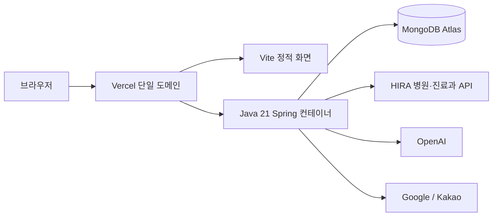

# 아키텍처

[기준 기획서](https://app.notion.com/p/879b8822a70f82f789298129ce73194d)의 범위를 바탕으로 로컬에서 구현한 앱을 통합했습니다. 현재 구성과 초기 계획을 구분하며, 운영 연결 결과는 [배포 안내](../infra/README.md)에 기록합니다.

- `frontend/`: React·TypeScript·Vite·TanStack Query. 상담·검색·예약·가입·마이페이지·관리자 UI와 서버 상태 관리.
- `backend/`: Java 21·Spring Boot 3·Security·Spring Data MongoDB·WebClient. JWT 인증·권한, 외부 API, 예약 정합성.
- MongoDB Atlas: 병원 정보·근거, 저장된 가상 의료진·시간표, 가입 완료 회원, 만료되는 소셜 가입·OAuth 임시 상태, 예약·요청 키·변경 이벤트.
- Vercel: 같은 프로젝트의 frontend와 backend services로 구성합니다. Java는 Container Runtime을 사용하며 기존 Oracle 배포 계획은 사용하지 않습니다.

## 코드 경계

Backend 패키지는 `auth`, `member`, `integration`, `booking`, `common`, `config`입니다. 기능별 controller가 service를 호출하고 service는 MongoTemplate·외부 API client를 사용합니다. HTTP 공개 필드와 저장 문서를 구분하며 비밀번호·소셜 식별번호·인증 토큰은 회원 목록 응답에 포함하지 않습니다.

Frontend는 `App.tsx`의 페이지 흐름, 소셜 가입 전용 컴포넌트, `ScrollStory.tsx`, 공통 요청 `api.ts`로 구성합니다. 기획 단계의 repository/DTO 및 features/pages 세분화는 현재 구현과 동일하지 않으며, 기존 기능을 유지한 채 필요한 범위에서 조정합니다.

## 인증과 데이터

일반 가입은 아이디·비밀번호·이름·전화번호를 받습니다. 구글·카카오는 고유 식별번호만 이용하며 이름·이메일·전화번호를 추가 입력받습니다. 입력한 이름·전화번호 조합으로 중복 가입을 차단합니다. 이메일·SMS 인증과 계정 자동 연결은 제공하지 않습니다.

가입 완료 전 소셜 인증은 만료되는 별도 임시 저장소에서 관리하며 `users` 회원이나 관리자 목록에 넣지 않습니다. 가입 완료 시 정식 회원 생성과 임시 자료 소모를 트랜잭션으로 처리합니다. OAuth 요청과 교환 티켓도 서버 교체·확장에 대비해 공유 저장소에서 유효기간과 일회성을 검사합니다.

예약은 조건부 정원 갱신과 MongoDB 다중 문서 트랜잭션으로 처리합니다. 증상 원문은 저장하지 않습니다. AI는 실제 조회한 병원 후보만 사용하며, 장애 시 직접 검색 또는 명시된 캐시·샘플 상태를 표시합니다. 의료진·시간표는 가상이며 실제 병원 접수를 제공하지 않습니다.

API·인증·DB·배포 설정을 변경하면 같은 PR에 관련 문서와 검증 결과를 기록합니다. [API 계약](api-contract.md), [DB 설계](database.md), [구현 상세](implementation-contract.md), [프로젝트 계획서](project-plan.md)를 함께 참고합니다.
