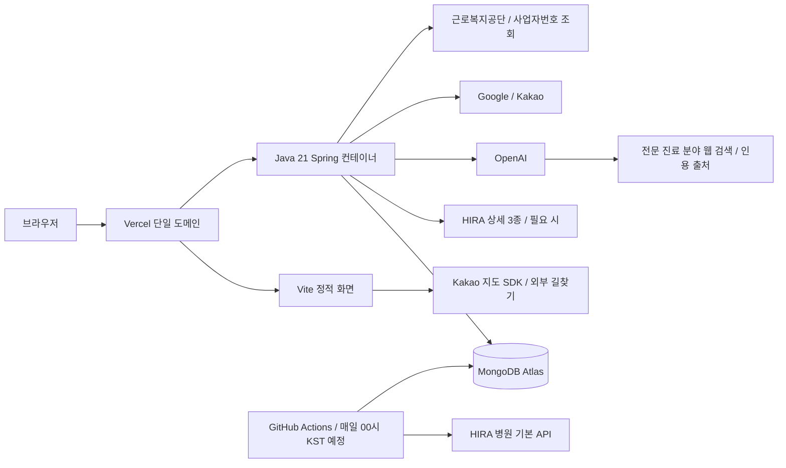

# 아키텍처

[기준 기획서](https://app.notion.com/p/879b8822a70f82f789298129ce73194d)의 범위를 바탕으로 로컬에서 구현한 앱을 통합했습니다. 현재 구성과 초기 계획을 구분하며, 운영 연결 결과는 [배포 안내](../infra/README.md)에 기록합니다.

- `frontend/`: React·TypeScript·Vite·TanStack Query. 상담·검색·예약·가입·마이페이지·관리자 UI와 서버 상태 관리.
- `backend/`: Java 21·Spring Boot 3·Security·Spring Data MongoDB·WebClient. JWT 인증·권한, 외부 API, 예약 정합성.
- MongoDB: 전국 병원 기본 카탈로그, 메디픽 등록 병원 명단, 선택 병원 상세 캐시·근거, 병원이 등록한 의료진·시간표, 개인·병원 회원, 가입·OAuth 임시 상태, 예약·요청 키·변경 이벤트. 운영은 Atlas를 사용하고 병원 회원 기능 검증은 별도 로컬 DB에서 진행합니다.
- Vercel: 같은 프로젝트의 frontend와 backend services로 구성합니다. Java는 Container Runtime을 사용하며 기존 Oracle 배포 계획은 사용하지 않습니다.
- GitHub Actions: 기본 병원 목록의 초기 적재·일일 동기화. 기본 API 전체 목록과 서비스에서 지원하는 진료과 필터 목록을 수집·검증한 뒤 MongoDB 변경분을 적용합니다. Vercel 운영 API를 경유하거나 매일 재배포하지 않습니다.

## 코드 경계

Backend 패키지는 `auth`, `member`, `integration`, `booking`, `common`, `config`입니다. 기능별 controller가 service를 호출하고 service는 MongoTemplate·외부 API client를 사용합니다. HTTP 공개 필드와 저장 문서를 구분하며 비밀번호·소셜 식별번호·인증 토큰은 회원 목록 응답에 포함하지 않습니다.

Frontend는 `App.tsx`의 페이지 흐름, 소셜 가입 전용 컴포넌트, `ScrollStory.tsx`, 공통 요청 `api.ts`로 구성합니다. 기획 단계의 repository/DTO 및 features/pages 세분화는 현재 구현과 동일하지 않으며, 기존 기능을 유지한 채 필요한 범위에서 조정합니다.

병원 상세 지도는 브라우저의 카카오 Web SDK로 표시합니다. 서버가 제공한 병원 좌표를 우선 사용하며 주소 변환도 SDK의 `services` 라이브러리로 처리합니다. 외부 길찾기는 카카오맵으로 연결하고 현재 위치를 수집하지 않습니다. 공개 JavaScript 키만 frontend 빌드 변수에 두며 서버의 카카오 REST API 키·Client Secret은 기존 인증 설정에 유지합니다.

## 병원 목록과 상세 정보

검색·홈·AI 추천의 병원 후보는 기획서의 병원 컬렉션인 `hospitals`에서 조회합니다. 방문자가 검색할 때 기본 API를 호출하지 않습니다. 일일 수집은 기본 목록의 `dgsbjtCd` 조건으로 진료과별 소속 병원도 확인하므로, 전국 병원의 상세 3종을 일괄 호출하지 않고 진료과 검색을 준비할 수 있습니다.

병원 가입 기능에서는 전체 기본 카탈로그를 유지하고 `hospitalRegistrations.status=ACTIVE`인 병원만 공개 검색·상세·추천·신규 예약에 제공합니다. 실제 운영 진료과는 병원이 등록한 활성 의료진을 기준으로 별도 관리합니다. 병원 가입 조회는 전체 카탈로그에서 사업자번호에 해당하는 병원 기본정보를 찾을 수 있습니다.

상담은 증상·경과·진료 목적과 희망 방향을 대화로 확인합니다. 주변 병·의원은 DB의 종별·진료과·주소·좌표를 사용하며, 전문 진료기관은 웹에서 공개 자료를 찾은 후 실제 DB의 기관명·분원·주소를 대조합니다. 공식 안내·기사·후기 등 출처 유형을 구분하고 검색 결과의 AI 요약으로 표시합니다. `hospitalRecommendationEvidence`에 개인 정보와 연결되지 않은 공개 검색 결과만 24시간 보관합니다. 응급이 의심되는 대화에서는 일반 추천보다 응급진료 안내를 우선합니다. 세부 흐름은 [대화형 추천](recommendations.md)에 설명합니다.

병원 상세를 열면 `hospitals`의 기본 정보와 `hospitalDetails`의 상세 캐시를 합칩니다. `hospitalDetails`는 기획서 이후 추가한 보조 컬렉션으로, 필요한 병원만 저장하고 같은 병원 ID를 사용해 예약·의료진의 참조를 유지합니다. HIRA 상세 3종의 1시간 캐시 정책은 유지합니다. `hospitals` 전체를 서버 시작 때 병원별로 정리하거나 `hospitalDetails`·`hospitalEvidence`에 복제하지 않습니다.

일일 동기화는 매일 한국 시간 00시로 예약하며, 실제 실행은 GitHub 스케줄 상황에 따라 늦어질 수 있습니다. 수집·검증 후 변경된 기본 문서만 수정하고, 전체 수집이 정상 완료된 경우에만 누락 자료를 비활성화합니다. 회원·예약은 이 일일 수집 대상이 아닙니다. 상세 흐름과 실패 복구는 [병원 목록 운영 안내](hospital-catalog.md)를 참고합니다.

## 인증과 데이터

일반 가입은 아이디·비밀번호·이름·이메일·전화번호를 받습니다. 구글·카카오는 고유 식별번호만 이용하며 이름·이메일·전화번호를 추가 입력받습니다. 개인 가입에는 이메일·문자 인증이 필요하며, 가입 방식과 이름에 관계없이 정규화한 전화번호 또는 이메일 중 하나라도 이미 등록돼 있으면 중복 가입을 차단합니다. 기존 가입 방식과 해당 로그인 버튼은 서버가 `SIGNUP` 문자 인증으로 확인한 번호와 가입 완료 개인 USER의 전화번호가 일치할 때 즉시 안내합니다. 이름·이메일은 안내 조건으로 비교하지 않으며 관리자·병원·미완료 소셜 계정은 제외합니다. 최종 가입의 중복 오류는 가입 방식을 포함하지 않는 공통 안내를 표시합니다. 별도 가입정보 찾기와 계정 자동 연결은 제공하지 않습니다. 기존 회원의 누락된 이메일은 그대로 보존합니다.

가입 완료 전 소셜 인증은 만료되는 별도 임시 저장소에서 관리하며 `users` 회원이나 관리자 목록에 넣지 않습니다. 가입 완료 시 정식 회원 생성과 임시 자료 소모를 트랜잭션으로 처리합니다. OAuth 요청과 교환 티켓도 서버 교체·확장에 대비해 공유 저장소에서 유효기간과 일회성을 검사합니다.

병원 가입은 사업자번호로 근로복지공단 API를 조회하고 이름·주소를 DB와 대조합니다. 병원명·주소·우편번호·전화번호는 서버에서 읽어 자동 입력하고 수정을 허용하지 않습니다. 이메일·소셜 가입은 사용하지 않습니다. 병원 계정과 등록 명단 생성, 일회용 조회 확인 소모는 한 트랜잭션입니다. 이 조회는 실제 운영자의 신원을 증명하지 않습니다. 현재 수업 프로젝트에는 승인 절차가 없으며, 실제 병원·환자가 이용하는 서비스에는 별도 운영 권한 확인이 필요합니다.

병원은 자기 병원의 의료진·일정·정원을 직접 관리하고 예약을 조회·변경·취소합니다. 서버는 로그인 병원 소속을 확인하고 다른 병원의 자료 접근을 거절합니다. 가상 의료진·일정 자동 생성은 중단하고 신규 예약에 사용하지 않습니다. 별도 병원 접수 시스템과 자동 연동하지는 않습니다.

예약은 조건부 정원 갱신과 MongoDB 다중 문서 트랜잭션으로 처리합니다. 증상 원문은 저장하지 않습니다. AI는 실제 조회한 등록 병원 후보만 사용하며, 등록 병원이 없으면 미등록·샘플 병원을 대신 추천하지 않습니다.

API·인증·DB·배포 설정을 변경하면 같은 PR에 관련 문서와 검증 결과를 기록합니다. [API 계약](api-contract.md), [DB 설계](database.md), [구현 상세](implementation-contract.md), [프로젝트 계획서](project-plan.md)를 함께 참고합니다.
