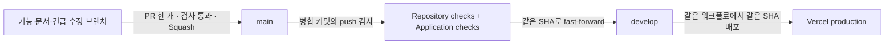

# 브랜치 운영

## 흐름

`main`에서 모든 작업을 시작하고, 작업 브랜치에서 `main`으로 PR 한 개를 엽니다. `develop`은 검사를 마친 `main`을 그대로 가리키며 GitHub Actions가 관리합니다. 작업과 충돌 해결은 작업 브랜치에서 진행합니다.

## 이름

작업 브랜치 이름은 `종류/영역/이슈번호-짧은-설명`으로 작성합니다. 영어 소문자·숫자·하이픈을 사용합니다.

| 종류 | 영역 | 예시 |
| --- | --- | --- |
| feat | backend / frontend / shared | `feat/backend/12-create-reservation` |
| fix | backend / frontend / shared | `fix/frontend/18-reservation-error` |
| refactor / test / style | backend / frontend / shared | `test/backend/20-reservation-concurrency` |
| chore / build / revert | backend / frontend / shared / infra | `build/infra/25-docker-image` |
| docs | 영역 생략 | `docs/3-api-contract` |
| hotfix | backend / frontend / shared / infra | `hotfix/backend/30-cancel-reservation` |

영역은 분류이며 사람을 뜻하지 않습니다. 같은 영역이라도 각자 별도 Issue·브랜치를 사용합니다. 이슈 번호는 예시이며 실제 번호를 사용합니다.

## 허용 PR 경로

기능, 문서, 긴급 수정 모두 작업 브랜치 → `main` 경로를 따릅니다. PR의 `Repository checks`와 `Application checks`가 성공하고 리뷰 대화를 해결하면 작성자가 **Squash and merge**합니다. 팀원 리뷰는 선택 사항입니다. PR 제목과 squash 커밋에는 GitHub가 해당 PR에 발급한 실제 번호를 사용합니다.

`Repository checks`는 PR의 출발·대상 브랜치 이름을 검사합니다. GitHub 서버의 보호 설정은 별도로 확인합니다. [저장소 설정 현황](repository-settings.md)

## 최초 작업 브랜치

- `chore/backend/1-project-init`: Spring Boot 초기 설정
- `chore/frontend/2-project-init`: React·TypeScript 초기 설정
- `docs/3-api-contract`: API·컬렉션 계약

프로젝트 초기에는 위 세 브랜치를 당시의 `develop`에서 생성했습니다. 새 작업 브랜치는 최신 `main`에서 생성합니다. [작업 시작 예시](../CONTRIBUTING.md#1-작업-시작)

## 릴리스

1. `main`에 병합된 커밋의 SHA를 확인합니다. `main` push의 `Application checks` 또는 `Repository checks`가 끝나면 `Vercel production`이 시작됩니다. 같은 SHA에서 두 검사의 최신 실행이 모두 성공해야 다음 단계로 진행합니다. 다른 검사가 진행 중이면 변경 없이 종료하고, 그 검사가 완료될 때 다시 확인합니다. 이미 같은 SHA를 성공적으로 배포했다면 자동 중복 배포는 건너뜁니다.
2. 워크플로는 최신 `main`을 다시 확인하고 `develop`을 해당 SHA로 fast-forward합니다. 두 이력이 갈라져 있으면 실행이 중단되므로 각 브랜치에만 있는 커밋부터 확인합니다.
3. 같은 워크플로가 이 SHA를 Vercel에 배포합니다. 성공하면 `main`과 `develop` 끝의 SHA 및 운영 배포의 소스 SHA가 모두 같습니다. [Actions 배포 이력](https://github.com/DavidPark04/hospital-reservation/actions/workflows/vercel-production.yml)

`GITHUB_TOKEN`으로 `develop`을 갱신하는 push는 새 push 워크플로를 실행하지 않습니다. 동기화와 배포를 한 워크플로에서 처리하는 이유입니다. [GitHub Actions의 토큰 동작](https://docs.github.com/en/actions/concepts/security/github_token)

수동 재배포도 현재 `main` SHA에 대한 `main` push 검사 두 개의 성공을 확인합니다. [배포 및 복구 절차](../infra/README.md)
