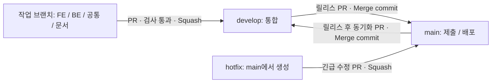

# 브랜치 운영

## 흐름



두 영구 브랜치 `main`, `develop`을 유지합니다. FE·BE별로 영구 통합 브랜치를 추가하지 않고, 작업별 브랜치 이름과 폴더로 구분합니다. 모든 일반 작업은 최신 `develop`에서 시작합니다.

두 브랜치 모두 PR은 필수이며 상대 승인은 선택입니다. 최신 대상 브랜치를 반영하고 필수 검사 통과·리뷰 대화 해결 후 작성자가 병합할 수 있습니다.

## 이름

형식: `종류/영역/이슈번호-짧은-설명`. 영어 소문자·숫자·하이픈을 사용합니다.

| 종류 | 영역 | 예시 |
| --- | --- | --- |
| feat | backend / frontend / shared | `feat/backend/12-create-reservation` |
| fix | backend / frontend / shared | `fix/frontend/18-reservation-error` |
| refactor / test / style | backend / frontend / shared | `test/backend/20-reservation-concurrency` |
| chore / build / revert | backend / frontend / shared / infra | `build/infra/25-docker-image` |
| docs | 영역 생략 | `docs/3-api-contract` |
| hotfix | backend / frontend / shared / infra | `hotfix/backend/30-cancel-reservation` |

영역은 분류이며 사람을 뜻하지 않습니다. 같은 영역이라도 각자 별도 Issue·브랜치를 사용합니다. 이슈 번호는 예시이며 실제 번호를 사용합니다.

## 허용 PR 경로

- 일반 작업 → `develop`
- `develop` → `main`: 릴리스
- `main` → `develop`: 릴리스·긴급 수정 동기화
- `hotfix/…` → `main`: 긴급 수정

이외 경로는 `Repository checks`가 실패하도록 검사합니다. 이 검사는 PR의 출발·대상 이름을 확인하며 GitHub 권한 통제를 대체하지 않습니다. 서버 측 보호 적용 여부는 [설정 현황](repository-settings.md)을 확인합니다.

## 최초 작업 브랜치

- `chore/backend/1-project-init`: Spring Boot 초기 설정
- `chore/frontend/2-project-init`: React·TypeScript 초기 설정
- `docs/3-api-contract`: API·컬렉션 계약

세 브랜치는 처음에는 `develop`과 동일한 커밋입니다. 브랜치 생성은 기능 구현 완료를 뜻하지 않습니다. 담당자는 Issue에서 정합니다.

```bash
git fetch origin
git switch --track origin/chore/backend/1-project-init
```

FE 담당은 frontend 브랜치를 선택합니다. 로컬 브랜치가 이미 있으면 `git switch 브랜치명`만 실행합니다.

## 릴리스

1. `develop`의 앱 테스트·빌드·시연 결과를 확인합니다.
2. `develop` → `main` PR을 만들고 `chore: v0.1.0 릴리스`처럼 제목을 붙입니다.
3. 필수 검사 통과·리뷰 대화 해결 후 **Create a merge commit**으로 병합합니다. 상대 승인은 필수가 아니며 릴리스를 Squash하지 않습니다.
4. `main` → `develop` 동기화 PR을 **Create a merge commit**으로 병합합니다.
5. 검증된 `main`에 `v0.1.0` 같은 태그를 붙이고 변경점·알려진 제한을 기록합니다.

현재는 배포 자동화가 없습니다. 배포 연결을 구현한 이후 운영 배포 트리거를 `main`으로 제한합니다.
