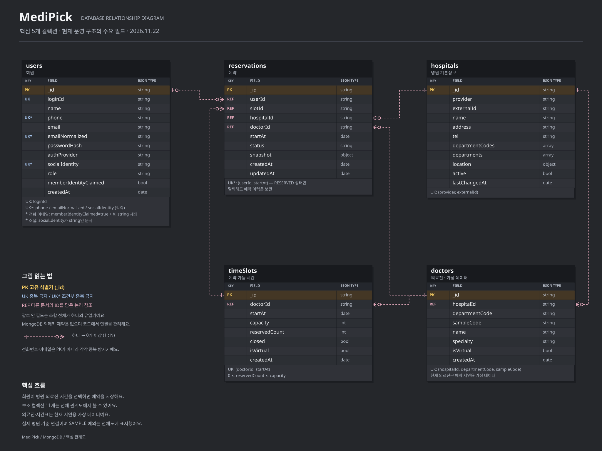
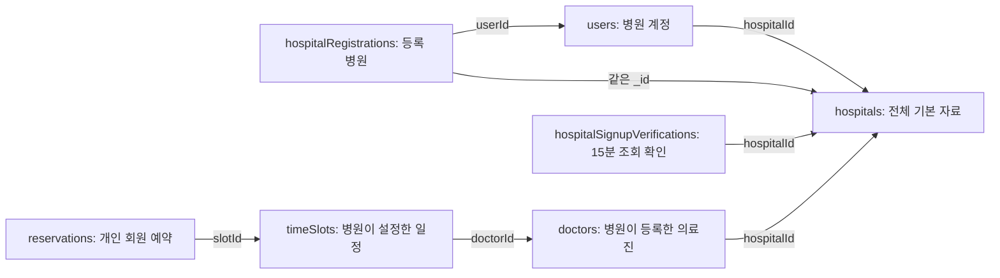

# MediPick DB 구조와 필드 설명

메디픽의 DB 이름은 **`MediPick`**이다. 이 문서는 현재 MongoDB에 어떤 정보가 들어가고, 각 필드가 무슨 뜻이며, 서로 어떻게 연결되는지를 처음 읽는 사람도 따라갈 수 있게 설명한다.

현재 구현은 **22개 컬렉션**으로 나뉜다. 먼저 회원·병원·의료진·시간표·예약 **핵심 5개**를 이해하면 된다. 병원 회원 추가로 `hospitalRegistrations`(등록 병원)와 `hospitalSignupVerifications`(가입 전 조회 확인)가 생겼다. 나머지는 인증, 중복 요청 방지, API 결과 재사용, 수집 작업 기록을 위한 보조 저장소다. 컬렉션 구조는 코드 기준이며 실제 배포 상태는 해당 PR·Actions 결과로 확인한다.

> 표의 이름·연락처·ID·건수는 설명용 가상 예시다. 실제 회원 정보, 비밀번호, API 키, DB 접속 정보는 포함하지 않는다. 필드는 현재 코드와 DB 메타데이터를 기준으로 설명하며, 같은 컬렉션 안에서도 가입 방식·문서 종류에 따라 선택 필드가 없을 수 있다.

## 읽는 순서

1. [사용자 동작으로 이해하기](#overview)
2. [타입·PK·UK·REF 등 용어](#terms)
3. [전체 22개 컬렉션 목록](#collections)
4. [핵심 5개 데이터](#core)
5. [병원 상세·추천·수집 보조 데이터](#hospital-support)
6. [예약 요청과 변경 이력](#booking-support)
7. [소셜·연락처 인증 임시 데이터](#social-support)
8. [데이터가 생기고 사라지는 흐름](#lifecycle)
9. [운영 규칙과 코드 위치](#operations)

## 1. 사용자 동작으로 이해하기

| 사용자가 하는 일 | DB에서 하는 일 |
| --- | --- |
| 개인 회원가입을 완료한다 | 이메일·문자 인증 증명을 소모하면서 `users`에 회원 한 명을 저장한다. |
| 병원 회원가입을 한다 | 사업자번호로 공공 API를 조회하고 DB 병원과 대조한 뒤 `users`와 `hospitalRegistrations`를 함께 저장한다. |
| 병원을 검색한다 | `hospitals`의 전체 기본 자료 중 `hospitalRegistrations`에 등록된 병원만 읽는다. |
| 병원을 선택한다 | 필요한 상세 정보를 `hospitalDetails`에서 읽고, 재사용할 수 없으면 API로 확인한다. 근거는 `hospitalEvidence`에도 저장한다. |
| 병원이 의료진·일정을 등록한다 | 자기 병원의 `doctors`와 `timeSlots`에 직접 입력한 정보를 저장한다. |
| 의료진과 시간을 고른다 | 등록 병원이 직접 설정한 활성 의료진과 예약 가능한 시간표를 읽는다. |
| 예약을 완료한다 | `reservations`에 예약을 저장하고 시간표의 예약 인원을 늘린다. `requests`는 중복 처리를 막고 `reservationEvents`는 이력을 남긴다. |
| 카카오·구글로 처음 로그인한다 | 소셜 인증에 성공해도 추가 정보 입력 전에는 `social_signups`에 가입 대기 정보만 둔다. 가입 완료 시 `users`로 정식 회원을 만든다. |

핵심 관계는 **회원이 특정 병원·의료진의 시간표를 골라 예약한다**는 것이다.

[핵심 그림 크게 보기](images/database-core.svg) · [병원 회원 추가 전 16개 관계도](images/database-full.svg)

기존 SVG 그림은 병원 회원 추가 전 구조다. 최신 필드와 병원 회원 관계는 아래 표와 관계도를 기준으로 읽는다. 병원 기본 정보와 상세 캐시는 같은 `_id`를 사용한다. 예전 시연용 자료는 남아 있을 수 있지만 일반 사용자의 신규 검색·예약에는 제공하지 않는다.

## 2. 먼저 알아둘 용어

### 컬렉션·문서·필드

엑셀에 비유하면 **컬렉션은 시트**, **문서는 한 행**, **필드는 열 이름**에 가깝다. 예를 들어 `users` 컬렉션 안에 회원 한 명의 문서가 있고, 그 문서에 `name`, `phone`, `email` 필드가 들어간다. MongoDB 문서에는 목록이나 다른 작은 객체를 함께 넣을 수도 있다.

### 타입은 어떤 종류의 값인지 알려 준다

| 표기 | 뜻 | 예시 |
| --- | --- | --- |
| `string` | 글자 데이터. 숫자처럼 보여도 문자열로 저장할 수 있다. | `"홍길동"`, `"01012345678"` |
| `bool` | 참 또는 거짓 | `true` / `false` |
| `int` | 정수 | 예약 인원 `2` |
| `double` | 소수점이 있는 숫자 | 위도 `37.5` |
| `number` | 숫자를 통틀어 적은 설명. 필드마다 저장 숫자 타입이 다를 수 있다. | 수집 건수 `100` |
| `date` | MongoDB의 날짜·시간 값 | `2026-11-22T06:30:00Z` = 한국 시간 15:30 |
| `object` | 여러 값을 담은 묶음 | `{latitude: 37.5, longitude: 127.0}` |
| `array` | 값이 여러 개 들어가는 목록 | `["01", "05"]` |
| `array<string>` / `array<object>` | 문자열 목록 / 객체 목록 | 진료과 코드 목록 / 코드·이름 묶음 목록 |
| `null` | 해당 값이 비어 있거나 확인되지 않았다고 명시한 값 | 자료 기준 기간을 모를 때 `null` |

`선택`은 모든 문서에 반드시 들어가는 필드가 아니라는 뜻이다. 예를 들어 소셜 회원에게는 일반 로그인용 `passwordHash`가 없다. 날짜는 UTC 기준으로 저장하고 화면에서 한국 시간으로 표시한다. 날짜처럼 보이는 ISO 문자열은 표에 `string`으로 따로 적었다.

### PK·UK·REF는 무엇인가?

| 표기 | 쉬운 뜻 | 메디픽 예시 |
| --- | --- | --- |
| **PK** | 데이터 한 건을 구분하는 기본 고유번호 | 모든 컬렉션의 `_id` |
| **UK** | 같은 값을 두 번 저장하지 못하게 하는 중복 방지키 | `users.loginId` |
| **UK\*** | 특정 조건을 만족하는 문서에만 적용하는 중복 방지키 | 가입 완료 회원의 비어 있지 않은 `phone`, `emailNormalized` 각각 |
| **복합 UK** | 필드 여러 개를 묶은 조합 전체가 같을 때 중복을 막는 키 | `(doctorId, startAt)` — 같은 의료진의 같은 시간표 중복 방지 |
| **REF** | 다른 문서의 고유번호를 저장해 연결하는 필드 | `reservations.userId` → `users._id` |
| **REF\*** | 조건에 따라 연결 대상이 달라지거나 선택적으로 있는 참조 | 로그인 티켓의 회원/가입 대기 ID |
| **조회 인덱스** | 자주 찾는 기준으로 검색을 빠르게 하는 색인 | 예약번호와 시각으로 변경 이력을 조회 |
| **TTL** | 만료 시각이 지난 문서를 MongoDB가 자동 정리하는 기능 | 60초 뒤 만료되는 소셜 로그인 티켓 |

PK·UK·REF는 그림의 설명 표시이며 그 이름의 필드를 따로 저장한다는 뜻이 아니다. **전화번호는 PK가 아니다.** 회원의 PK는 `_id`이고, 전화번호·이메일은 각각 중복 방지 조건에 사용한다. 현재 `_id`는 문자열이며 용도에 따라 UUID, 해시, 고정 이름 등으로 만든다.

MongoDB는 위 REF를 SQL 외래키처럼 강제하지 않는다. 앱이 대상 확인과 트랜잭션으로 관계를 관리한다. 회원 탈퇴 후에는 과거 예약의 `userId`가 가리키는 회원 문서가 없어질 수 있다.

### 자주 나오는 처리 용어

| 용어 | 쉬운 설명 |
| --- | --- |
| 정규화 값 | 같은 정보를 비교하기 쉽도록 표현을 통일한 값. 예: 이메일을 소문자로 바꾼 `emailNormalized` |
| 해시 | 원문을 그대로 쓰는 대신 계산해 만든 지문. 병원 정보 변경 비교, 비밀번호 검증 등에 사용하며 용도에 맞는 알고리즘을 쓴다. |
| 캐시 | 이미 가져온 정보를 다시 쓰기 위해 저장해 둔 것. API를 반복 호출하는 횟수를 줄인다. |
| 스냅샷 | 특정 시점의 정보 사본. 예: 예약 당시 병원 이름·주소 |
| 트랜잭션 | 여러 변경을 한 작업으로 묶어 전부 성공하거나 전부 되돌리는 방식 |
| 토큰 | 로그인한 사용자임을 서버에 보여 주는 확인값. `tokenVersion`은 기존 토큰을 더 이상 쓰지 못하게 할 때 사용하는 버전이다. |

TTL 정리는 정확히 만료 시각에 즉시 끝난다고 가정하지 않는다. 인증·캐시 코드는 만료 시각도 직접 확인한다. `expiresAt` 필드가 있다고 무조건 TTL이 적용되는 것은 아니다. 수집 잠금은 코드가 만료를 관리한다.

## 3. 전체 22개 컬렉션 목록

| 구분 | 컬렉션 | 한 문장 설명 |
| --- | --- | --- |
| 핵심 | [`users`](#users) | 가입 완료 개인·병원 회원과 관리자 |
| 핵심 | [`hospitals`](#hospitals) | 미리 수집한 전국 병원 기본 정보 |
| 핵심 | [`doctors`](#doctors) | 병원이 직접 등록한 의료진 |
| 핵심 | [`timeSlots`](#timeSlots) | 예약할 수 있는 시간과 자리 수 |
| 핵심 | [`reservations`](#reservations) | 개인 회원의 예약 |
| 병원 가입 | [`hospitalRegistrations`](#hospitalRegistrations) | 병원 계정과 실제 병원을 연결하고 공개 여부를 관리 |
| 병원 가입 | [`hospitalSignupVerifications`](#hospitalSignupVerifications) | 사업자번호·DB 병원 대조 결과를 가입 때까지 임시 보관 |
| 병원·AI 보조 | [`hospitalDetails`](#hospitalDetails) | 선택한 병원의 상세 API 결과 캐시 |
| 병원·AI 보조 | [`hospitalEvidence`](#hospitalEvidence) | 병원 공공 정보의 출처와 확인 시점 |
| 병원·AI 보조 | [`hospitalRecommendationEvidence`](#hospitalRecommendationEvidence) | 기사·공식 자료 등 웹 추천 근거 캐시 |
| 병원·AI 보조 | [`hospitalImportRuns`](#hospitalImportRuns) | 기본 정보 수집 작업의 성공·실패·변경 건수 |
| 병원·AI 보조 | [`chat_usage`](#chat_usage) | 하루 상담 횟수 카운터 |
| 예약 보조 | [`requests`](#requests) | 같은 예약 요청이 두 번 처리되는 것을 방지 |
| 예약 보조 | [`reservationEvents`](#reservationEvents) | 예약 생성·변경·취소 이력 |
| 소셜 인증 보조 | [`social_signups`](#social_signups) | 추가 정보 입력 전의 소셜 가입 대기 |
| 소셜 인증 보조 | [`oauth_authorization_requests`](#oauth_authorization_requests) | 외부 인증 페이지로 갔다 돌아오는 요청 검증 |
| 소셜 인증 보조 | [`social_login_tickets`](#social_login_tickets) | 인증 결과를 앱 로그인으로 넘기는 일회용 티켓 |
| 소셜 인증 보조 | [`social_withdrawal_proofs`](#social_withdrawal_proofs) | 같은 소셜 계정으로 재인증한 탈퇴 확인서 |
| 연락처 인증 보조 | [`contactVerificationChallenges`](#contactVerificationChallenges) | 5분짜리 이메일 코드 확인 요청 |
| 연락처 인증 보조 | [`contactVerificationProofs`](#contactVerificationProofs) | 최종 작업에 한 번 쓰는 10분짜리 인증 증명 |
| 연락처 인증 보조 | [`contactVerificationLimits`](#contactVerificationLimits) | 이메일 재발송 간격과 횟수 제한 |
| 연락처 인증 보조 | [`phoneVerificationReceipts`](#phoneVerificationReceipts) | 같은 Firebase 문자 인증의 재교환 방지 |

진료과는 별도 `departments` 컬렉션이 아니다. 공공 자료는 `hospitals.departments`, 병원이 실제 운영하도록 설정한 진료과는 `hospitalRegistrations.departments`에 둔다. 후자는 활성 의료진의 진료과를 모아 만들며 앱의 `Departments` 코드표를 사용한다.

## 4. 핵심 5개 데이터

### `users` — 가입을 완료한 회원

개인 회원, 병원 회원, 관리자를 함께 저장하고 `role`로 구분한다. 개인은 기존 아이디 가입 또는 카카오·구글 가입을 사용한다. 병원은 사업자번호와 비밀번호로 가입·로그인하며 이메일과 소셜 로그인을 사용하지 않는다.

| 필드 | 타입 | 쉬운 설명 | 예시·저장 조건 |
|---|---|---|---|
| `_id` | string | 회원 한 명을 구분하는 고유번호(PK). 예약 등에서 이 번호로 회원을 연결한다. | 임의로 생성한 UUID 문자열 |
| `loginId` | string | 개인 로그인 아이디 또는 내부 관리용 아이디 | 개인: `member01` / 소셜: `kakao_`, `google_` 접두어 / 병원: `hospital:` + 사업자번호. 병원 화면에서는 사업자번호만 입력 |
| `name` | string | 개인은 입력한 이름, 병원은 DB에서 확인한 병원명 | `홍길동` / `예시의원` |
| `nameNormalized` | string | 이름을 비교하기 위해 공백·유니코드·영문 대소문자를 정리한 값. 이름 자체에 중복 금지 제약은 없다. | `  Hong   Gil  ` → `hong gil` |
| `phone` | string | 개인은 정규화한 입력 연락처. 병원은 DB의 병원 전화번호를 복사 | 개인: `01012345678`. 병원 전화번호가 없으면 빈 문자열 |
| `email` | string, 선택 | 개인 회원이 직접 입력한 이메일. 병원 계정에는 저장하지 않는다 | `Member@example.com` |
| `emailNormalized` | string | 이메일 중복 검사에 쓰는 값. 앞뒤 공백을 제거하고 소문자로 저장한다. | `Member@example.com` → `member@example.com` |
| `passwordHash` | string | 비밀번호 원문 대신 저장하는 BCrypt 해시값. 로그인할 때 입력한 비밀번호와 비교한다. | 일반 개인·병원 계정에 저장. 소셜 계정에는 서비스 비밀번호가 없다. |
| `authProvider` | string | 어떤 방식으로 가입했는지. | `LOCAL` 일반 / `GOOGLE` 구글 / `KAKAO` 카카오 |
| `socialSubject` | string | 구글·카카오가 발급한 계정 고유번호를 문자열로 저장한 값. | 구글의 `sub` 또는 카카오의 `id`. 소셜 회원만 저장. |
| `socialIdentity` | string | 서비스 이름과 소셜 고유번호를 합친 값. 서로 다른 소셜 서비스의 번호를 구분하고, 같은 소셜 계정의 중복 회원 생성을 막는다. | `KAKAO:123456` / `GOOGLE:example-subject` |
| `role` | string | 개인 회원·병원 회원·관리자 구분 | `USER` / `HOSPITAL` / `ADMIN` |
| `businessNumber` | string, 병원만 | 병원 로그인에 사용하는 사업자등록번호. PK는 아니다 | 하이픈 없는 10자리 |
| `hospitalId` | string, 병원만 | 이 계정이 관리하는 병원의 고유번호(REF) | `hospitals._id` |
| `memberIdentityClaimed` | bool | 이 문서의 전화번호·이메일에 중복 제한을 적용하는지 표시한다. | 일반·소셜 가입 완료 시 `true`. 연락처가 없는 이전 데이터에는 없을 수 있다. |
| `profileComplete` | bool | 소셜 로그인 후 추가 정보 입력을 마쳤는지. | 소셜 가입 완료 시 `true`. 일반 회원은 이 필드가 없어도 가입 완료로 판단한다. |
| `profileCompletedAt` | date | 소셜 회원이 이름·이메일·전화번호 입력을 마친 시각. | 소셜 가입 완료 시 저장 |
| `emailSource` | string | 이메일을 어디서 가져왔는지. | 현재 가입 흐름은 직접 입력이므로 `USER` |
| `emailVerified` | bool | 이메일 인증을 완료했는지 표시하는 값. | 신규 개인 가입·이메일 변경 성공 시 `true`. 기존 누락/`false`는 자동 승격하지 않음 |
| `phoneVerified` | bool | 저장된 휴대전화의 문자 인증 여부. | 신규 개인 가입·개인 비밀번호 변경/재설정 성공 시 `true` |
| `tokenVersion` | int | 현재 유효한 로그인 토큰의 버전. 숫자가 달라지면 이전 토큰을 사용할 수 없다. | 가입 시 `0`; 로그아웃·비밀번호 변경/재설정·이메일 변경 때 증가 |
| `bookingVersion` | int | 예약 처리와 회원 삭제가 동시에 일어날 때 충돌을 감지하기 위한 내부 번호. 사용자에게 보여 주는 값은 아니다. | 예약 생성·변경·취소 처리 중 증가. 예약 작업 전에는 없을 수 있다. |
| `createdAt` | date | 회원가입을 완료한 시각. | `2026-11-22T06:30:00Z` |
| `lastLoginAt` | date | 일반 아이디·비밀번호 로그인에 성공한 최근 시각. | 일반 로그인 성공 시 갱신. 현재 소셜 로그인 흐름에서는 갱신하지 않는다. |

`memberIdentityClaimed=true`는 **본인 인증·이메일 인증·전화번호 인증을 완료했다는 뜻이 아니다.** 연락처 중복 제한을 적용하기 위한 내부 값이다. 연락처 인증 여부는 `emailVerified`, `phoneVerified`로 별도 기록한다. 기존 회원의 미인증 상태도 유지할 수 있지만 새 개인 가입에는 두 인증이 필요하다.

병원 계정에는 개인용 연락처 중복 제한을 적용하지 않는다. 병원 가입은 `hospitalRegistrations`의 사업자번호·병원번호·계정번호 중복 제한으로 관리한다. 병원의 소속 정보는 로그인 토큰의 표시만 믿지 않고 DB의 활성 등록과도 대조한다. 본인 탈퇴는 개인 `USER`만 가능하다. 관리자는 개인·병원 회원을 삭제할 수 있으며 모든 `ADMIN` 계정은 삭제 대상에서 보호한다.

#### 중복을 막는 키

| 대상 | 규칙 | 실제 인덱스 이름 |
|---|---|---|
| `_id` | 모든 회원의 고유번호가 달라야 한다. | `_id_` |
| `loginId` | 아이디가 같으면 가입할 수 없다. | `user_login_id_v1` |
| `phone` | `memberIdentityClaimed=true`이고 비어 있지 않은 문자열일 때 전화번호 중복을 막는다. | `user_phone_v1` |
| `emailNormalized` | `memberIdentityClaimed=true`이고 비어 있지 않은 문자열일 때 이메일 중복을 막는다. | `user_email_v1` |
| `socialIdentity` | 문자열로 저장된 소셜 계정 식별값의 중복을 막는다. | `user_social_identity_v1` |

전화번호와 이메일은 **각각 따로 중복을 막는 키**다. 두 필드를 합친 복합키가 아니며, 전화번호가 PK인 것도 아니다. 이름 및 이름+전화번호 조합에는 현재 유일 인덱스가 없다.

#### 중복 가입 안내 방식

전화번호 또는 이메일이 중복이면 가입은 막는다. 기존 가입 방식은 `SIGNUP` 문자 인증이 서버 검증을 통과한 뒤, 인증된 전화번호와 일치하는 가입 완료 개인 USER가 있을 때만 안내한다. 이름·이메일은 비교하지 않으며 관리자·병원·미완료 소셜 계정은 안내 대상에서 제외한다.

| 일치 조건 | 안내 |
|---|---|
| 인증된 전화번호가 일치, 가입 완료 개인 계정이 카카오 | 이미 카카오로 가입된 계정이 있어요. 카카오로 로그인해 주세요. |
| 위 조건이 일치, 기존 계정이 구글 | 이미 구글로 가입된 계정이 있어요. 구글로 로그인해 주세요. |
| 위 조건이 일치, 기존 계정이 일반 가입 | 이미 일반 가입으로 등록된 계정이 있어요. 아이디로 로그인해 주세요. |
| 최종 가입 요청에서 전화번호 또는 이메일 중복 | 이미 가입된 정보가 있어요. 기존에 가입한 방법으로 로그인해 주세요. |

문자 인증 성공 응답은 인증 증명과 함께 선택 필드 `existingAuthProvider`를 반환하며, 기존 회원의 이름·이메일·회원번호는 공개하지 않는다. 해당 필드는 다른 인증 목적과 이메일 인증, 최종 가입의 중복 오류에는 포함하지 않는다. 일반·소셜 가입 화면은 전화번호 인증 상태와 잠금을 유지하면서 즉시 기존 방식의 로그인 버튼을 표시하고 가입 완료를 막는다. 연락처별 중복 방지 인덱스는 그대로 유지한다. 입력한 이름의 실명 여부를 확인하거나 기존 계정을 자동 통합하지는 않는다.

### `hospitals` — 전국 병원 기본 정보

병원 이름·주소·전화번호 등 병원 검색과 병원 가입 대조의 기준 자료다. **전국 기본 데이터는 계속 보관하지만 웹 검색·추천·예약은 메디픽에 등록한 병원으로 제한한다.** `hospitals.active=true`만으로 서비스에 가입한 병원이라는 뜻은 아니며, `hospitalRegistrations.status=ACTIVE`도 함께 확인한다. 사용자가 검색할 때마다 병원 기본 API를 호출하지 않는다.

| 필드 | 타입 | 쉬운 설명 | 가상 예시·값 |
| --- | --- | --- | --- |
| `_id` | string / PK | 메디픽 안에서 사용하는 병원 고유번호. HIRA 기관번호가 같으면 같은 UUID를 만든다 | `병원 UUID` |
| `provider` | string | 기본 정보를 제공한 곳 | `HIRA` |
| `externalId` | string | HIRA가 사용하는 기관 식별값. API의 `ykiho` | `HIRA 기관 식별값` |
| `name` | string | 병원 이름 | `메디픽 예시병원` |
| `address` | string | 병원 주소 | `서울특별시 예시구 예시로 10` |
| `tel` | string | 병원 전화번호. 회원 전화번호와 별개 | `02-0000-0000` |
| `source` | string | 이 자료가 공공 API에서 왔다는 표시 | `LIVE` |
| `sourceUrl` | string | 사용한 기본 API의 안내 페이지 주소 | 공공데이터포털 병원정보서비스 페이지 |
| `active` | bool | 현재 기본 목록에 포함되어 검색·새 예약에 사용할 수 있는지 | `true` |
| `location` | object 또는 null | 지도에 쓸 위도·경도를 한 묶음으로 저장 | `{latitude: 37.5, longitude: 127.0}` |
| `latitude` | double, 선택 | 위도. 유효한 좌표가 있을 때만 별도 필드로도 저장 | `37.5` |
| `longitude` | double, 선택 | 경도. 유효한 좌표가 있을 때만 별도 필드로도 저장 | `127.0` |
| `apiFields` | object | 기본 API가 반환한 원본 필드 전체. 이 객체 안의 값은 문자열 | `{yadmNm: "메디픽 예시병원", addr: "…", …}` |
| `departmentCodes` | array<string> | 이 병원이 속한 지원 진료과 코드 목록 | `["01", "05"]` |
| `departments` | array<object> | 진료과 코드와 이름을 함께 저장한 목록 | `[{code: "01", name: "내과"}]` |
| `basicSourceHash` | string | 기본 API 원본이 이전과 같은지 비교하는 SHA-256 지문 | `64자리 해시값` |
| `catalogHash` | string | 기본 원본 지문과 진료과 목록을 합쳐 만든 비교 지문 | `64자리 해시값` |
| `basicFetchedAt` | date | 현재 저장된 기본 원본을 API에서 가져왔던 시각 | `2026-11-22T00:10:00Z` |
| `fetchedAt` | date | 기본 정보의 조회 시각. 신규·기본 원본 변경 시 `basicFetchedAt`과 함께 저장 | 위 시각과 같음 |
| `firstImportedAt` | date | 이 병원을 처음 DB에 추가한 시각 | 첫 적재 시각 |
| `lastChangedAt` | date | 기본 내용·진료과 소속·활성 상태가 마지막으로 변경된 시각 | 마지막 실제 변경 시각 |
| `retiredAt` | date, 선택 | 정상 전체 수집 목록에서 빠져 비활성화한 시각. 다시 나타나면 제거 | 비활성화 시각 |

`apiFields`의 예로 `ykiho`(기관 식별값), `yadmNm`(병원명), `addr`(주소), `telno`(전화번호), `XPos`(경도), `YPos`(위도)가 있다. API가 보내는 그 밖의 기본 필드도 보존하므로 원본 객체의 필드는 병원·API 응답에 따라 달라질 수 있다. 브라우저 응답에는 `apiFields`, `externalId`, 비교용 해시를 그대로 내보내지 않는다.

**키와 연결:** `(provider, externalId)` 조합이 유일하다. `provider` 하나나 `externalId` 하나에 각각 독립적인 UK를 만든 구조는 아니다. 실제 병원의 `hospitalDetails._id`, 의료진과 예약의 `hospitalId`에서 같은 병원 ID를 사용한다. 병원 검색은 `(active, name, _id)`와 `(departmentCodes, active, name, _id)` 인덱스를 사용한다. 가입 시에는 `(apiFields.postNo, active)` 인덱스로 같은 우편번호의 활성 병원을 찾는다.

**왜 해시·날짜가 여러 개인가?** 해시는 변경 여부를 빨리 비교하고, 날짜는 언제 가져온 자료인지 구분한다. 내용이 같으면 병원 문서에 날짜만 다시 쓰지 않는다. 따라서 오늘 전체 수집에 성공했어도 어떤 병원의 `basicFetchedAt`은 며칠 전일 수 있다. 오늘 작업의 성공 여부는 아래 `hospitalImportRuns`에서 확인한다. `active:false`는 원본 목록에서 확인되지 않는다는 뜻이며 폐업을 확정하는 값은 아니다.

### `hospitalRegistrations` — 메디픽에 가입한 병원

`hospitals`가 전국 병원 자료라면 이 컬렉션은 **그중 메디픽에 가입한 병원의 명단**이다. 현재는 병원 하나당 병원 계정 하나를 연결한다. 의료진마다 로그인 계정을 만드는 구조는 아니다.

| 필드 | 타입 | 쉬운 설명 |
| --- | --- | --- |
| `_id` | string / PK·REF | 연결한 `hospitals._id`와 같은 값. 같은 병원을 두 번 등록하지 못함 |
| `businessNumber` | string / UK | 하이픈 없는 사업자등록번호 10자리. 같은 사업자번호의 중복 가입 방지 |
| `userId` | string / UK·REF | 병원을 관리하는 `users._id`. 한 계정으로 병원 여러 개를 연결하지 못함 |
| `status` | string | `ACTIVE`인 등록만 공개·관리 대상으로 사용 |
| `basicInformation` | object | 가입 때 DB에서 확인한 `id`, `name`, `address`, `postalCode`, `tel` 사본 |
| `departments` | array<object>, 선택 | 병원이 등록한 활성 의료진의 진료과 코드·이름 목록 |
| `departmentCodes` | array<string>, 선택 | 위 목록의 진료과 코드. 공개 검색의 진료과 조건에 사용 |
| `managementVersion` | int, 선택 | 병원 관리 작업이 동시에 실행될 때 충돌을 감지하는 내부 번호 |
| `createdAt` | date | 병원 가입 완료 시각 |

사업자번호 인덱스는 `hospital_registration_business_v1`, 계정번호 인덱스는 `hospital_registration_owner_v1`이다. 병원 계정 생성과 이 등록 문서 생성은 하나의 트랜잭션으로 처리한다. 활성 의료진이 없으면 운영 진료과 목록도 비어 있다. 의료진 등록·수정과 운영 진료과 갱신 역시 같은 트랜잭션이다.

관리자가 병원 회원을 삭제하면 계정과 등록 문서의 병원 ID·소유자·사업자번호가 일치하는지 확인한 뒤 계정과 등록을 함께 삭제한다. 의료진은 `active:false`, 일정은 `closed:true`로 보존하고, 해당 병원의 활성 예약을 취소해 정원을 반환하며 이력을 남긴다. 관련 사업자 조회 인증 자료도 삭제한다. 이 작업은 하나의 트랜잭션이다. `hospitals` 기본 자료와 예약·이벤트 이력은 삭제하지 않는다. 등록이 제거되므로 같은 병원의 재가입은 새 사업자 조회부터 가능하며 기존 의료진·일정은 자동으로 다시 열리지 않는다.

**자동 입력되는 병원명·주소·우편번호·전화번호는 사용자가 수정할 수 없다.** 전화번호는 DB에 있으면 그대로 넣고 없으면 빈칸으로 둔다. 가입 요청에 임의 값을 넣어 보내도 서버는 현재 DB의 기본정보를 사용한다. 관리 화면의 기본정보도 현재 `hospitals`에서 읽는다.

### `hospitalSignupVerifications` — 병원 가입 전 조회 확인

공단 사업장과 `hospitals`를 대조한 뒤, 선택이 필요하면 제시한 후보 목록을 저장한다. 사용자가 후보를 고르면 서버는 선택 문서를 소비하고 가입 확인 문서를 같은 트랜잭션에서 만든다. 병원 하나가 직접 일치하면 가입 확인 문서를 바로 만든다. 두 단계 모두 카탈로그의 원래 이름과 주소 등 기본정보를 보관해 변경 여부를 확인한다.

| 필드 | 타입 | 쉬운 설명 |
| --- | --- | --- |
| `_id` | string / PK | 일회용 `selectionToken` 또는 `verificationToken`의 SHA-256 해시 |
| `businessNumber` | string | 조회한 사업자등록번호 |
| `candidates` | array | 선택 문서에 저장한 후보별 `id`, `name`, `address`, `postalCode`, `tel` |
| `hospitalId` | string / REF | 가입 확인 문서에 저장한 병원의 `hospitals._id` |
| `hospital` | object | 가입 확인 문서에 저장한 병원의 DB 기본정보 |
| `createdAt` | date | 해당 문서를 발급한 시각 |
| `expiresAt` | date | 최초 조회 후 15분. 후보 선택 후에도 같은 만료 시각 적용 |

가입 완료 시 확인 문서를 소모하며, 계정·등록 생성과 확인 문서 삭제를 같은 트랜잭션으로 처리한다. 조회 이후 DB 기본정보가 바뀌었어도 재조회를 요구한다. TTL 인덱스 `hospital_signup_verification_expiry_v1`이 만료 자료를 정리하고 서버도 만료 시각을 직접 검사한다.

**사업자 정보와 병원이 일치했다는 확인은 가입한 사람이 실제 병원 운영자인지 증명하지 않는다.** 실제 병원·환자가 이용하는 서비스에는 별도의 병원 운영 권한 확인이 필요하다. 현재 수업 프로젝트에는 관리자 승인·운영자 본인 인증 절차를 추가하지 않았다.

### `doctors` — 병원이 직접 등록한 의료진

병원 계정이 의료진 이름·진료과·전문 분야를 등록하고 수정한다. 공공 API에서 의사 실명 명단을 받거나 임의의 이름을 자동 생성하지 않는다. 기존 시연 자료가 DB에 남더라도 신규 예약 대상은 `isVirtual=false`, `active=true`인 의료진이다.

| 필드 | 타입 | 쉬운 설명 | 예시 |
| --- | --- | --- | --- |
| `_id` | string | 의료진 한 명의 고유번호(PK) | 새 UUID |
| `hospitalId` | string | 어느 병원에 속하는지 나타내는 연결 번호(REF) | 해당 병원의 `_id` |
| `departmentCode` | string | 소속 진료과 코드 | `05` = 정형외과 |
| `departmentName` | string | 화면에 보여 줄 진료과 이름 | `정형외과` |
| `sampleCode` | string | 기존 복합 인덱스와 호환하기 위한 내부 식별값. 신규 값은 순번이 아님 | `managed-` + 의료진 UUID. 예전 자료에는 `sample-0` 등 |
| `name` | string | 병원에서 입력한 의료진 이름 | 설명용 예시 `김하늘` |
| `specialty` | string | 병원에서 입력한 전문 분야 | `관절 진료` |
| `active` | bool | 신규 예약을 받는 의료진인지 | `true` / `false` |
| `isVirtual` | bool | 예전 시연 자료인지 구분 | 병원 직접 등록은 `false` |
| `bookingVersion` | int, 선택 | 의료진 설정 변경과 예약이 겹칠 때 충돌을 감지하는 내부 번호 | 예약 처리 시 증가 |
| `createdAt` | date | 의료진 등록 시각 | 생성 시각 |
| `updatedAt` | date, 선택 | 의료진 정보 수정 시각 | 수정 시각 |

**중복 방지:** `(hospitalId, departmentCode, sampleCode)` 조합이 같으면 두 번 생성할 수 없다. `sampleCode` 하나가 전국에서 유일해야 한다는 뜻은 아니다. 서로 다른 병원은 각각 `sample-0`을 가질 수 있다.

예정된 예약이 있는 의료진의 진료과 변경은 거절한다. 의료진을 비활성화하면 신규 예약을 막지만 이미 있는 예약은 유지하므로 병원이 따로 변경·취소할 수 있다.

### `timeSlots` — 예약할 수 있는 시간과 자리 수

“김하늘 의료진의 11월 23일 오전 9시에는 4명까지 예약할 수 있다”를 한 문서로 저장한다. 병원이 메디픽에서 날짜·시작/종료 시간·간격·정원을 직접 설정한다. 다른 병원 접수 시스템과 자동 연동하는 기능은 없다.

| 필드 | 타입 | 쉬운 설명 | 예시 |
| --- | --- | --- | --- |
| `_id` | string | 시간표 한 칸의 고유번호(PK) | 의료진 ID와 시작 시각으로 만든 UUID |
| `doctorId` | string | 누구의 시간표인지(REF) | `doctors._id` |
| `startAt` | date | 진료 시작 날짜와 시간 | 한국 시간 `2026-11-23 09:00` |
| `capacity` | int | 이 시간에 받을 수 있는 최대 예약 인원 | `4` |
| `reservedCount` | int | 현재 예약된 인원 | `2` |
| `closed` | bool | 이 시간을 휴진·예약 불가로 처리했는지 | `false` = 열림, `true` = 닫힘 |
| `isVirtual` | bool | 시연용 시간표인지 | 직접 등록한 일정은 `false` |
| `createdAt` | date | 이 시간표를 처음 만든 시각 | 생성 시각 |

**남은 자리**는 `capacity - reservedCount`로 계산한다. 예를 들어 정원 4명, 예약 2명이면 2자리다. API 응답의 `remaining`은 이 계산 결과이며 DB에 별도로 저장하는 필드는 아니다. `endAt` 필드도 현재 저장하지 않는다.

**중복 방지:** `(doctorId, startAt)`가 같으면 같은 의료진의 같은 시간표를 두 번 만들 수 없다. DB 자체 검사로 `0 ≤ reservedCount ≤ capacity`를 유지한다. 조회만으로 일정을 만들지 않는다. 같은 시간을 다시 생성해도 기존 정원·휴진 설정을 덮어쓰지 않으며, 수정 API로 정원·휴진을 변경한다. 예약 수보다 정원을 줄이거나 예약이 있는 시간을 휴진 처리하는 요청, 지난 일정 수정은 거절한다.

### `reservations` — 개인 회원의 예약

“어떤 회원이 어느 병원·의료진의 어떤 시간을 예약했는지”를 저장한다. 의료진·병원 ID를 함께 저장하므로 예약 목록을 보여 줄 때 필요한 대상을 바로 알 수 있다.

| 필드 | 타입 | 쉬운 설명 | 예시 |
| --- | --- | --- | --- |
| `_id` | string | 예약 한 건의 고유번호(PK) | 새로 만든 UUID |
| `userId` | string | 예약한 회원번호(REF) | `users._id` |
| `slotId` | string | 선택한 시간표 번호(REF) | `timeSlots._id` |
| `hospitalId` | string | 예약 병원번호(REF) | 해당 병원의 `_id` |
| `doctorId` | string | 예약 의료진 번호(REF) | `doctors._id` |
| `startAt` | date | 예약한 진료 시작 시각 | 한국 시간 `2026-11-23 09:00` |
| `status` | string | 예약 상태 | `RESERVED` 예약 유지 / `CANCELED` 취소 |
| `hospitalName` | string | 예약에 표시할 병원 이름 사본 | `예시병원` |
| `departmentCode` | string | 예약한 진료과 코드 사본 | `05` |
| `departmentName` | string | 예약한 진료과 이름 사본 | `정형외과` |
| `doctorName` | string | 예약한 의료진 이름 사본 | `김하늘` |
| `isVirtual` | bool, 선택 | 예전 시연 예약인지 | 신규 병원 등록 기반 예약은 `false`. 이전 자료에는 필드가 없을 수 있음 |
| `snapshot` | object | 예약 생성·변경 당시 병원과 의료진 정보를 따로 담은 묶음 | 아래 표 참고 |
| `createdAt` | date | 예약을 처음 만든 시각 | 예약 생성 시각 |
| `updatedAt` | date | 예약을 생성·변경·취소한 최근 시각 | 마지막 처리 시각 |

`snapshot`은 **그 시점의 정보를 복사해 둔 것**이다. 나중에 병원 기본 정보가 바뀌더라도 당시 예약에 사용한 정보를 확인할 수 있다. 예약을 다른 일정으로 변경하면 새 일정의 정보로 갱신한다.

| `snapshot` 안의 필드 | 타입 | 뜻 |
| --- | --- | --- |
| `hospitalName` | string | 당시 병원 이름 |
| `address` | string | 당시 병원 주소 |
| `tel` | string | 당시 병원 전화번호 |
| `doctorName` | string | 당시 의료진 이름 |
| `isVirtual` | bool | 신규 병원 등록 기반 예약은 `false`. 예전 시연 예약은 `true` |
| `source` | string | 병원 정보의 출처 표시 |

**중복 방지:** `status=RESERVED`인 예약에만 `(userId, startAt)` 조합의 중복을 막는다. 한 회원이 같은 시각에 병원이 다른 예약을 두 개 유지할 수 없다. 취소한 예약은 이 제한에서 제외한다.

**보관:** 취소했다고 예약 문서를 삭제하지 않는다. 회원 탈퇴 때도 활성 예약을 취소하고 예약 이력은 남긴다. 따라서 과거 `userId`가 가리키는 회원이 현재 `users`에는 없을 수 있다.

**병원 권한:** 개인은 자기 예약을, 병원은 자기 `hospitalId`로 들어온 예약만 조회·변경·취소한다. 병원 화면에는 예약자의 이름·전화번호만 추가하고 이메일·비밀번호 해시·회원번호는 반환하지 않는다. 병원이 다른 병원 일정으로 예약을 옮길 수 없으며, 변경·취소 시 자리 수·요청 결과·이력을 함께 처리한다. 병원 계정은 개인용 진료 예약을 생성하지 못한다.

## 5. 병원 상세·추천·수집 보조 데이터

### `hospitalDetails` — 선택한 병원의 상세 캐시

캐시는 **이미 가져온 정보를 잠시 재사용하려고 저장해 두는 것**이다. 전체 병원의 기본 목록은 `hospitals`에 있고, 사용자가 선택한 병원의 상세 API 결과는 여기에 쌓인다. 실제 병원은 `hospitals`와 `_id`를 공유하므로 별도의 `hospitalId` 필드가 없다. 시연용 `SAMPLE` 병원은 이 컬렉션에만 있을 수 있다.

| 필드 | 타입 | 쉬운 설명 | 가상 예시·값 |
| --- | --- | --- | --- |
| `_id` | string / PK·REF | 실제 병원은 기본 정보와 같은 병원 ID. 샘플은 별도 문자열 ID | `병원 UUID` / `sample-…` |
| `provider` | string | 자료 제공 구분 | `HIRA` / `SAMPLE` |
| `externalId` | string | 실제 기관 식별값 또는 샘플 ID | `HIRA 기관 식별값` |
| `name` | string | 선택 당시 저장한 병원 이름 사본 | `메디픽 예시병원` |
| `address` | string | 병원 주소 사본 | `서울특별시 예시구 예시로 10` |
| `tel` | string | 병원 전화번호 사본 | `02-0000-0000` |
| `location` | object 또는 null | 지도 좌표 묶음 | `{latitude: 37.5, longitude: 127.0}` |
| `latitude` | number, 선택 | 좌표가 있을 때의 위도 | `37.5` |
| `longitude` | number, 선택 | 좌표가 있을 때의 경도 | `127.0` |
| `source` | string | 실제 공공 자료인지 시연용 자료인지 | `LIVE` / `SAMPLE` |
| `departments` | array<object> | 상세 API로 확인한 진료과 목록. 상세 조회 전에는 기본 목록의 진료과를 사용 | `[{code: "01", name: "내과"}]` |
| `departmentCode` | string, 선택 | 화면·예약에서 대표로 선택한 진료과 코드 | `01` |
| `departmentName` | string, 선택 | 위 대표 진료과 이름 | `내과` |
| `evidence` | array<object> | 병원 기본·진료과·특수진료·전문병원 지정의 근거 목록 | 아래 `hospitalEvidence`와 같은 근거 구조 |
| `basicFetchedAt` | date 또는 null | 기본 자료의 조회 시각 사본. 오래된 자료는 확인 불가이면 null 가능 | 기본 조회 시각 |
| `detailFetchedAt` | date, 선택 | 가장 최근 상세 응답을 저장한 시각 | 상세 조회 시각 |
| `detailComplete` | bool, 선택 | 상세 3종을 모두 성공적으로 확인했는지 | `true`면 완전한 상세 캐시 |
| `fetchedAt` | date | 기본·상세 조회를 종합한 표시 시각 | 더 최근 조회 시각 |

**중요한 구분:** 기본 정보 사본이 있더라도 실제 병원 응답은 `hospitals`의 현재 기본 정보와 상세 캐시를 합쳐 만든다. 상세 문서에 있는 오래된 주소 사본을 그대로 최신 주소로 사용하지 않는다. 응답의 `source=CACHE`는 이번 요청이 저장된 정보를 재사용했다는 뜻이며, DB의 `source=LIVE`는 공공 API에서 온 자료라는 뜻이다.

**키:** `(provider, externalId)` 복합 UK. TTL 자동 삭제 인덱스는 없다.

**상세 3종 재사용 규칙:**

1. 진료과(`getDgsbjtInfo2.8`), 특수진료(`getSpclDiagInfo2.8`), 전문병원 지정 분야(`getSpclHospAsgFldList2.8`)를 필요할 때 호출한다.
2. 완전한 결과이고 `detailFetchedAt`이 1시간 이내이면 DB 캐시를 사용한다.
3. 캐시가 없거나 오래되었거나 일부만 성공했던 결과라면 다음 상세 요청에서 다시 확인한다. 1시간이 지났다고 DB 문서를 자동 삭제하지는 않는다.
4. 특수진료·전문병원 지정 조회 중 일부가 실패하면 실패한 종류의 과거 근거를 유지하고 `detailComplete:false`를 기록한다. 확인 실패를 “해당 진료를 하지 않음”으로 바꾸지 않는다.
5. 진료과 등 상세 조회 전체 흐름이 실패하면 마지막 저장 자료를 표시한다. 성공한 종류는 새 근거로 교체하며, 상세 문서와 분리된 근거 문서를 같은 트랜잭션에서 맞춘다.

### `hospitalEvidence` — 공공 API 근거

“이 병원의 진료과가 내과라는 정보는 어디에서 언제 확인했는가?”를 저장한다. **웹 기사·블로그 추천 근거와는 다른 컬렉션**이다.

| 필드 | 타입 | 쉬운 설명 | 가상 예시·값 |
| --- | --- | --- | --- |
| `_id` | string / PK | 근거 한 건의 ID. 실제 근거는 병원 ID·종류·내용으로 같은 ID를 만든다 | `근거 UUID` |
| `hospitalId` | string / REF | 어느 병원의 근거인지 | `병원 UUID` |
| `kind` | string | 근거 종류 | `BASIC`, `DEPARTMENT`, `SPECIAL`, `DESIGNATION`, `SAMPLE` |
| `label` | string | 화면에 표시할 종류 이름 | `진료과목` |
| `value` | string | 확인한 내용 | `내과` |
| `sourceUrl` | string | 원본 API 안내 페이지. 샘플은 빈 문자열 | 공공데이터포털 상세정보서비스 페이지 |
| `basePeriod` | string 또는 null | 원본이 명시한 자료 기준 기간. 확인되지 않으면 null | `null` |
| `fetchedAt` | date | 이 근거를 가져온 시각 | API 조회 시각 |

`BASIC`은 병원명·주소·연락처, `DEPARTMENT`는 진료과, `SPECIAL`은 특수진료, `DESIGNATION`은 전문병원 지정 분야를 뜻한다. `fetchedAt`은 서버가 정보를 가져온 날짜이고 `basePeriod`는 원본 자료가 다루는 기간이므로 서로 대신 쓰지 않는다. 현재 새 공공 근거는 기준 기간을 알 수 없어 `basePeriod:null`로 저장한다.

`hospitalDetails.evidence`는 화면에서 함께 읽기 위한 내장 목록이고, 이 컬렉션은 근거를 병원·종류별로 갱신할 수 있도록 별도 문서로도 보관한다. 샘플의 내장 근거에는 `_id`·`hospitalId`가 없을 수 있지만 독립된 `hospitalEvidence` 문서에는 두 값이 있다. `_id` 외 별도 unique/TTL 인덱스는 현재 없다.

### `hospitalRecommendationEvidence` — 공개 웹 추천 근거 캐시

특정 진료 분야·희망 지역으로 찾은 웹 검색 결과를 24시간 재사용한다. 같은 분야를 다른 사용자가 물어봐도 같은 검색 조건이면 재사용할 수 있다. 사용자별 상담 기록 저장소가 아니다.

| 필드 | 타입 | 쉬운 설명 | 가상 예시·값 |
| --- | --- | --- | --- |
| `_id` | string / PK | 검색 버전·AI 모델·진료 분야·지역을 묶어 만든 SHA-256 식별값 | `64자리 해시값` |
| `version` | string | 검색·검증 규칙의 버전 | `hospital-expertise-v4` |
| `candidates` | array<object> | 웹 자료에서 찾은 후보 병원. 최대 5곳 | `[{name: "메디픽 예시병원", …}]` |
| `checkedAt` | date | 검색 결과를 확인해 캐시에 넣은 시각 | 검색 확인 시각 |
| `expiresAt` | date / TTL | 이 캐시가 유효한 마지막 시각 | `checkedAt`에서 24시간 뒤 |

후보 한 개의 구조:

| 중첩 필드 | 타입 | 쉬운 설명 | 가상 예시 |
| --- | --- | --- | --- |
| `candidates[].name` | string | 출처에 나온 병원명·분원명 | `메디픽 예시병원` |
| `candidates[].address` | string | 해당 병원을 구분하는 전체 주소 | `서울특별시 예시구 예시로 10` |
| `candidates[].specialty` | string | 검색한 질환·진료 분야 | `소화기내과` |
| `candidates[].reason` | string | 인용 출처를 바탕으로 작성한 짧은 후보 안내 이유 | `출처에서 소화기내과 진료 프로그램을 소개함` |
| `candidates[].sources` | array<object> | 후보 설명에 연결된 출처. 최대 3개 | 출처 목록 |
| `sources[].url` | string | 공개 웹 출처 링크 | `https://example.org/hospital-guide` |
| `sources[].title` | string | 출처 페이지 제목 | `예시 진료 프로그램 안내` |
| `sources[].checkedAt` | string | 해당 출처의 확인 시각을 ISO 문자열로 저장 | `2026-11-22T00:10:00Z` |

최상위 `checkedAt`은 MongoDB `date`지만 출처 안의 `checkedAt`은 **문자열**이라는 차이가 있다. `_id`가 유일하고 `expiresAt`에는 TTL 0초 인덱스가 있다. 앱에서도 `expiresAt`을 직접 검사하므로 TTL 삭제가 늦어져도 만료 캐시를 새 결과로 사용하지 않는다.

공식 자료를 우선하되 공개 기사·블로그·카페·SNS 자료도 사용할 수 있다. 후기·광고를 객관적인 치료 성과나 병원 순위로 저장하지 않으며, 출처가 연결되지 않는 후보는 제외한다. 캐시에는 사용자 ID·증상 원문·정밀 위치가 들어가지 않는다. **`hospitalId`는 없다.** 후보의 이름·주소를 기본 병원 목록과 맞추는 일은 추천 처리 코드가 별도로 한다.

### `hospitalImportRuns` — 병원 기본 정보 수집 작업 기록

병원별 의료 정보가 아니라 **“이번 대상 지역의 목록을 잘 가져왔는가, 몇 개가 바뀌었는가?”를 기록하는 작업 일지**다. 한 컬렉션에 실행 기록, 전국·지역별 적용 기준, 마지막 실행 요약과 잠금 문서가 들어가며, 모든 문서에 모든 필드가 있는 것은 아니다.

| 문서의 `_id` | 뜻 |
| --- | --- |
| 실행마다 만든 UUID | 이번 수집 반영 작업 한 번의 시작·성공·실패 기록 |
| `hospital-basic-current` | 전국 17개 지역을 성공적으로 반영한 마지막 수집의 기존 기준. 부분 수집으로 덮어쓰지 않음 |
| `hospital-basic-high-water` | 전국 수집 중 적용을 시작한 최신 기준. 부분 수집에서도 이전 전국 자료보다 오래된 역적용을 차단 |
| `hospital-basic-region-current:<지역코드>` | 해당 지역에서 마지막으로 성공한 수집의 기준 |
| `hospital-basic-region-high-water:<지역코드>` | 해당 지역에 적용을 시작한 최신 기준. 일부 반영 후 실패했어도 이전 자료의 덮어쓰기를 차단 |
| `hospital-basic-last-run` | 지역·전국 구분 없이 마지막 성공 실행의 대상 지역·건수·시각 요약 |
| `hospital-basic-sync-lock` | 두 수집 작업이 동시에 DB를 수정하지 않도록 하는 임시 잠금 |

| 필드 | 타입 | 쉬운 설명 | 가상 예시·값 |
| --- | --- | --- | --- |
| `_id` | string / PK | 위 표의 실행 ID 또는 제어 문서 이름 | `실행 UUID` |
| `runId` | string, 제어 문서 | current/high-water가 가리키는 실행 문서의 ID | `실행 UUID` |
| `provider` | string | 자료 제공처 | `HIRA` |
| `kind` | string | 수집 자료 종류 | `BASIC` |
| `regions` | string[] | 이번 실행이 검증·반영하는 HIRA 지역 코드 목록 | `["110000"]` |
| `region` | string, 지역 제어 문서 | 해당 기준이 적용되는 HIRA 지역 코드 | `110000` |
| `regionScopes` | object, 실행 요약 | 대상 지역별 기본·진료과 건수와 조회 시각 | `{ "110000": {scopeCounts: {…}, scopeTimes: {…}} }` |
| `status` | string | 실행 진행 상태 | `IMPORTING`, `COMPLETE`, `FAILED` |
| `startedAt` | date | DB 반영 작업 시작 시각 | 작업 시작 시각 |
| `completedAt` | date | 검증까지 성공한 작업 완료 시각 | 작업 완료 시각 |
| `failedAt` | date, 실패 시 | 실패가 기록된 시각 | 실패 시각 |
| `errorCode` | string, 실패 시 | 실패 이유를 나타내는 코드 | `database_operation_failed` |
| `expectedRows` | number | 해당 문서의 대상 지역에서 예상한 병원 수. 부분 수집에서는 전국 총건수가 아님 | `100` (설명용) |
| `rows` | number | 이번 실행 범위에서 확인한 병원 수 | `100` (설명용) |
| `inserted` | number | 새로 추가한 수 | `2` (설명용) |
| `updated` | number | 기존 활성 병원 중 내용이 바뀐 수 | `3` (설명용) |
| `reactivated` | number | 다시 목록에 나타나 활성화한 수 | `1` (설명용) |
| `unchanged` | number | 내용이 같아 쓰기를 생략한 수 | `94` (설명용) |
| `retired` | number | 검증한 대상 지역의 전체 목록에서 빠져 비활성화한 수 | `1` (설명용) |
| `verified` | number, 성공 실행 | 저장 후 원본과 다시 대조한 수 | `100` (설명용) |
| `sourceHash` | string | 수집 파일 전체의 SHA-256 체크섬. 파일 변경 여부 확인 | `64자리 해시값` |
| `scopeCounts` | object | 이번 대상 지역의 기본 목록·진료과별 수집 건수 | `{basic: 100, "01": 30, …}` |
| `scopeTimes` | object | 수집 범위별 최초·최종 조회 시각. 내부 시각은 ISO 문자열 | `{basic: {firstFetchedAt: "…", lastFetchedAt: "…"}, …}` |
| `firstFetchedAt` | date, 제어 문서 | 전체 수집 자료 중 가장 이른 조회 시각 | 수집 시작 쪽 시각 |
| `lastFetchedAt` | date, 제어 문서 | 전체 수집 자료 중 가장 늦은 조회 시각 | 수집 종료 쪽 시각 |
| `owner` | string, 잠금 문서 | 현재 잠금을 보유한 실행자의 임시 UUID | `잠금 소유자 UUID` |
| `expiresAt` | date, 잠금 문서 | 작업 잠금의 유효 기한. 갱신하며 유지 | 갱신 시점에서 15분 뒤 |

건수 필드는 정수로 사용하는 JavaScript 숫자이며 BSON 저장 시 숫자 타입으로 들어간다. 예시 건수는 실제 운영 통계가 아니다. `inserted + updated + reactivated + unchanged = rows`이고, `retired`는 새 목록에서 빠진 기존 자료라 이 합계와 별도로 센다.

**키와 만료:** `_id`가 유일하다. 잠금에 `expiresAt` 필드가 있어도 이 컬렉션에는 TTL 인덱스가 없다. 코드가 유효 시각과 소유자를 검사하고 정상 종료 시 잠금을 지운다. 30초 간격 갱신으로 잠금 만료 시각을 연장한다. `runId`는 같은 컬렉션의 실행 기록을 가리키는 논리 연결이지 MongoDB가 강제하는 FK는 아니다.

**요일별 갱신 흐름:** 월~토 한국 시간 00시 예약된 GitHub Actions가 당일 대상 지역의 기본 API를 전체 확인하고, 검증한 자료를 기존 DB와 비교한다. 월 서울, 화 경기, 수 부산·전남광주·경남, 목 대구·인천·경북, 금 전북·충남·대전, 토 충북·강원·울산·제주·세종·광주 별도 코드이며 일요일은 실행하지 않는다. 신규는 추가, 바뀐 것은 수정, 대상 지역에서 누락된 자료는 비활성화하고 같은 자료는 쓰지 않는다. 수집하지 않은 지역의 자료는 그대로 보존한다. 기본 원본이 같고 진료과만 바뀌었다면 기본 필드와 기본 조회 시각은 다시 쓰지 않는다.

최신 수집 기준은 지역별로 비교하여 다른 지역의 독립적인 갱신을 막지 않는다. 기존 기관번호가 다른 지역에서 확인되면 현재 저장된 지역의 최신 기준도 확인하므로 오래된 수집으로 이전 지역에 되돌리지 않는다. 전국 수집은 모든 지역의 기준과 대조한다. 갱신은 Vercel 함수가 아니라 GitHub runner에서 MongoDB에 직접 적용하고, 예정 시각은 runner 사정에 따라 늦어질 수 있다. 기본 API에 변경분 전용 조회가 있는 것은 아니므로 **대상 지역의 전체 API 확인과 DB 변경분 저장은 별개**다. 상세 일정·파일 검증·재실행은 [병원 목록 운영 안내](hospital-catalog.md)를 따른다.

전체 DB를 한 번에 교체하는 트랜잭션은 아니다. 적용 도중 실패하면 일부가 반영될 수 있으므로 같은 검증 자료로 재실행하고 `COMPLETE`·최종 검증 건수를 확인한다. 대량 누락·오래된 수집본·체크섬 불일치 등은 적용을 막는다. 상세 3종은 이 요일별 지역 수집에 포함되지 않는다. 상세 운영·복구 명령은 [병원 목록 운영 안내](hospital-catalog.md)를 따른다.

### `chat_usage` — 하루 상담 사용량

서버가 여러 대여도 하루 상담 횟수를 같이 계산하기 위한 작은 카운터다. **채팅 내용 저장소가 아니다.**

| 필드 | 타입 | 쉬운 설명 | 가상 예시·값 |
| --- | --- | --- | --- |
| `_id` | string / PK | 한국 날짜와 호출자 구분값을 HMAC-SHA256으로 바꾼 64자리 해시. 날짜·IP·회원 ID가 평문으로 보이지 않는다 | `64자리 해시값` |
| `count` | int | 오늘 해당 호출자가 사용한 상담 요청 횟수 | `3` |
| `expiresAt` | date / TTL | 다음 한국 시간 자정 | 다음 날 00시의 UTC 시각 |

현재 제한은 비회원 하루 20회, 회원 하루 60회다. `_id`는 날짜가 바뀌면 달라지고 `expiresAt` TTL 0초 인덱스로 지난 카운터가 정리된다. 증상 원문·원본 IP·회원 ID는 이 문서에 저장하지 않는다. HMAC의 키로 앱의 JWT 비밀값을 사용하지만 비밀값 자체를 DB 카운터에 넣지 않는다.

## 6. 예약 요청과 변경 이력

### `requests` — 같은 예약 요청의 두 번 처리를 막는 기록

사용자가 예약 버튼을 두 번 누르거나, 네트워크 오류로 같은 요청이 다시 전송되었을 때 예약이 두 번 만들어지는 것을 막는다. 모든 웹 접속을 기록하는 로그가 아니라 **예약 생성·변경·취소 요청의 재처리 방지용**이다.

| 필드 | 타입 | 쉬운 설명 | 예시 |
| --- | --- | --- | --- |
| `_id` | string | 요청 처리 기록의 고유번호(PK) | 새 UUID |
| `userId` | string | 요청한 개인 또는 병원 계정(REF) | `users._id`. 병원이 변경한 예약에서는 예약한 환자가 아닌 처리한 병원 계정 |
| `key` | string | 프런트엔드가 요청에 붙인 재시도 구분값 | 요청 헤더 `Idempotency-Key`의 값 |
| `requestHash` | string | 요청 내용이 같은지 비교하는 해시값 | 요청 종류·예약/시간표 번호로 계산 |
| `responseSnapshot` | object | 처음 성공했을 때 돌려준 예약 결과 사본 | 예약 ID·상태·병원·진료 시각 등 |
| `createdAt` | date | 처음 성공적으로 처리한 시각 | 처리 시각 |

**중복 방지:** `(userId, key)`가 유일하다. 같은 회원이 같은 키와 같은 내용으로 요청하면 이전 성공 응답을 돌려준다. 같은 키를 다른 내용에 재사용하면 충돌로 거절한다.

독립적인 `reservationId` 필드는 없다. 예약 번호는 `responseSnapshot` 안의 응답에 포함될 수 있다. 이 컬렉션에는 TTL이 없고, 회원 삭제 때 해당 회원의 기록을 정리한다.

### `reservationEvents` — 예약이 어떻게 바뀌었는지 남기는 이력

현재 예약 상태는 `reservations`에서 보고, “처음 생성하고 다른 시간으로 변경한 뒤 취소했다” 같은 과정은 이 컬렉션에서 확인한다.

| 필드 | 타입 | 쉬운 설명 | 예시 |
| --- | --- | --- | --- |
| `_id` | string | 변경 이력 한 건의 고유번호(PK) | 새 UUID |
| `reservationId` | string | 어느 예약의 이력인지(REF) | `reservations._id` |
| `actorId` | string | 누가 처리했는지(REF) | 개인·병원 계정 또는 관리자의 `users._id` |
| `action` | string | 수행한 작업 | `CREATE` 생성 / `CHANGE` 변경 / `CANCEL` 취소 / `HOSPITAL_CHANGE` 병원 변경 / `HOSPITAL_CANCEL` 병원 취소 |
| `before` | object 또는 null | 작업 전 예약 응답의 사본 | 처음 생성할 때는 `null` |
| `after` | object | 작업 후 예약 응답의 사본 | 변경된 시각·상태 등 |
| `createdAt` | date | 작업한 시각 | 이력 발생 시각 |

`(reservationId, createdAt)`는 예약별 이력을 찾기 위한 **조회 인덱스**다. 중복 금지키가 아니므로 같은 시각에 이력이 여러 개 생길 수 있다. 회원이 탈퇴해도 이력은 남으며, `actorId`가 가리키는 현재 회원은 없을 수 있다.

## 7. 소셜·연락처 인증 임시 데이터

소셜 인증 4개와 연락처 인증 4개 컬렉션은 회원 목록이 아니라 인증 중 필요한 임시 정보다. 소셜 가입 대기에는 이름·이메일·전화번호를 저장하지 않는다. 연락처 인증 요청·증명에는 검증 대상 연락처를 만료 시각까지 보관하고, 가입 완료 후 회원 연락처는 `users`에 저장한다.

### `social_signups` — 소셜 인증 후 가입을 기다리는 임시 정보

처음 카카오·구글로 로그인했지만 아직 이름·이메일·전화번호 입력을 마치지 않은 상태다. 이때는 `users`에 회원을 만들지 않는다. 가입 완료 시 새 회원 UUID를 만들어 `users`에 저장하고 임시 문서를 삭제한다.

| 필드 | 타입 | 쉬운 설명 | 예시·저장 조건 |
|---|---|---|---|
| `_id` | string | 가입 대기 건의 임시 고유번호(PK). 정식 회원번호와 다르다. | `signup_` + UUID |
| `authProvider` | string | 어느 소셜 서비스로 인증했는지. | `GOOGLE` / `KAKAO` |
| `socialSubject` | string | 해당 서비스의 계정 고유번호. | 가상의 카카오 번호 `123456` |
| `socialIdentity` | string | 서비스 이름과 고유번호를 합친 값. 동일 소셜 계정의 가입 대기를 하나로 유지한다. | `KAKAO:123456` |
| `tokenVersion` | int | 가입 대기 인증의 버전. 같은 계정으로 새로 인증하면 증가하여 이전 가입 토큰을 무효화한다. | 첫 대기 생성은 `1`, 다시 인증하면 `2` |
| `createdAt` | date | 이 가입 대기 문서가 처음 만들어진 시각. | 다시 인증해도 최초 생성 시각 유지 |
| `expiresAt` | date | 가입 대기 인증이 끝나는 시각. | 마지막 소셜 인증 후 30분 |

- `socialIdentity`는 단독 유일키(`social_signup_identity_v1`)다.
- `expiresAt`에는 TTL 인덱스(`social_signup_expiry_v1`)가 있다. 가입 완료·가입 대기 중 로그아웃 때도 삭제한다.
- 이름·이메일·전화번호·비밀번호는 이 컬렉션에 저장하지 않는다.
- 코드의 `registrationPending`은 다음 로그인 단계에 전달하는 메모리상의 표시이며, 이 컬렉션에 저장되는 필드는 아니다.

### `oauth_authorization_requests` — 소셜 로그인 왕복 과정의 임시 확인 정보

사용자가 메디픽에서 구글·카카오로 이동했다가 돌아올 때, 처음 요청한 브라우저의 로그인 요청이 맞는지 확인한다. OAuth는 외부 계정으로 인증하는 절차를 뜻한다.

| 필드 | 타입 | 쉬운 설명 | 예시·저장 조건 |
|---|---|---|---|
| `_id` | string | OAuth 요청의 `state`를 SHA-256으로 해시한 고유번호(PK). | 임의 확인값의 해시. 원문은 표에 적지 않는다. |
| `bindingHash` | string | 로그인을 시작한 브라우저와 돌아온 브라우저가 같은지 확인하는 쿠키값의 해시. | 브라우저 확인용 해시 |
| `provider` | string | 인증을 진행하는 소셜 서비스. | 이 컬렉션에서는 소문자 `google` / `kakao` |
| `authorizationUri` | string | 사용자를 보내는 소셜 서비스의 인증 페이지 주소. | 해당 제공자의 OAuth 인증 URL |
| `clientId` | string | 소셜 개발자 설정에 등록된 메디픽 앱 식별자. | 실제 발급 값은 문서에 기재하지 않는다. |
| `redirectUri` | string | 인증 완료 후 메디픽으로 돌아오는 주소. | `/login/oauth2/code/google`로 끝나는 콜백 URL |
| `scopes` | array(string) | 해당 요청에서 요구한 인증 범위 목록. | 요청 구성에 따른 범위 문자열 목록 |
| `parameters` | object | 제공자에게 함께 보내는 필요한 추가 인증 옵션. | 허용된 문자열 키만 저장 |
| `attributes` | object | 인증 검증·탈퇴 재인증에 필요한 내부 값. | 아래 중첩 필드 참고 |
| `expiresAt` | date | 요청이 끝나는 시각. | 생성 후 5분 |

`parameters`와 `attributes` 내부에는 다음 필드 중 필요한 것만 저장된다. 모두 `string`이다.

| 경로 | 쉬운 설명 |
|---|---|
| `parameters.nonce` | 인증 응답이 이번 요청에 해당하는지 확인하는 값 |
| `parameters.code_challenge` | 인증 코드를 가로채서 사용하는 것을 막기 위한 확인값 |
| `parameters.code_challenge_method` | 위 확인값을 생성하는 방식 |
| `parameters.prompt` | 로그인 화면이나 계정 선택 화면을 다시 보여 달라는 요청. 탈퇴 재인증에서는 카카오 `login`, 구글 `select_account` 사용 |
| `attributes.nonce` | 서버가 인증 응답을 검증할 때 사용하는 nonce 값 |
| `attributes.code_verifier` | 위 code challenge와 짝을 이루는 서버 측 확인값 |
| `attributes.withdrawal_user_id` | 탈퇴 재인증을 시작한 `users._id`. 일반 로그인에는 없다. |
| `attributes.withdrawal_identity` | 탈퇴하려는 회원의 `socialIdentity` |
| `attributes.withdrawal_version` | 탈퇴 시작 시점의 `tokenVersion`을 문자열로 저장한 값 |

콜백을 처리할 때 조회와 삭제를 함께 하므로 완료된 요청은 재사용할 수 없다. `expiresAt` TTL 인덱스는 `oauth_authorization_expiry_v1`이다. 이 컬렉션에 제공자의 액세스 토큰·프로필 정보·원본 브라우저 쿠키값을 저장하지 않는다.

### `social_login_tickets` — 소셜 인증 결과를 로그인 토큰으로 교환하는 일회용 티켓

소셜 인증 콜백 뒤 프런트엔드가 로그인 토큰을 받는 짧은 연결 단계다. 회원이거나 가입 대기 중인 대상을 가리킬 수 있다.

| 필드 | 타입 | 쉬운 설명 | 예시·저장 조건 |
|---|---|---|---|
| `_id` | string | 임의 발급한 교환 티켓의 SHA-256 해시(PK). | 티켓 원문 대신 해시 저장 |
| `userId` | string | 티켓을 받을 대상의 ID. 아래 `signupPending`에 따라 연결 대상이 달라진다. | `users._id` 또는 `social_signups._id` |
| `tokenVersion` | int | 티켓 생성 당시 대상의 인증 버전. 교환 시 현재 버전과 비교한다. | `0`, `1` 등 |
| `signupPending` | bool | 가입 대기 티켓인지. | `false`: 회원 로그인 / `true`: 추가 정보 입력 단계 |
| `expiresAt` | date | 티켓 사용 가능 시간이 끝나는 시각. | 생성 후 60초 |

`signupPending=false`이면 `userId → users._id`, `true`이면 `userId → social_signups._id`다. 두 컬렉션을 동시에 가리키는 뜻이 아니다. 교환할 때 문서를 삭제해 한 번만 사용할 수 있다. TTL 인덱스는 `social_login_ticket_expiry_v1`이다.

### `social_withdrawal_proofs` — 소셜 회원의 탈퇴 재인증 확인서

기존 소셜 OAuth 탈퇴 경로에서 같은 소셜 계정으로 다시 인증한 사실을 짧게 보관한다. 재인증만으로 탈퇴하지 않으며 최종 확정에는 이 확인서와 별도의 `WITHDRAWAL` 문자 인증 증명을 함께 요구한다. 현재 개인 탈퇴 화면은 등록 휴대전화 문자 인증을 사용하는 공통 `/api/members/me` 경로로 처리할 수 있다.

| 필드 | 타입 | 쉬운 설명 | 예시·저장 조건 |
|---|---|---|---|
| `_id` | string | 임의 발급한 탈퇴 확인서 값의 SHA-256 해시(PK). | 확인서 원문 대신 해시 저장 |
| `userId` | string | 탈퇴하려는 회원번호. | `users._id` 논리 참조 |
| `socialIdentity` | string | 재인증한 소셜 계정. 원래 가입한 계정과 같은지 확인한다. | `KAKAO:123456` |
| `tokenVersion` | int | 재인증 당시 회원의 로그인 버전. 중간에 로그인 상태가 바뀌었는지 확인한다. | 회원의 현재 `tokenVersion` |
| `expiresAt` | date | 확인서 사용 가능 시간이 끝나는 시각. | 생성 후 5분 |

확정할 때 한 번 사용하고 삭제한다. 새 탈퇴 인증 시작·탈퇴 취소·회원 삭제 때도 정리한다. TTL 인덱스는 `social_withdrawal_proof_expiry_v1`이다. 관리자(`ADMIN`)는 이 회원 탈퇴 흐름을 사용할 수 없다.

### `contactVerificationChallenges` — 이메일 인증번호 확인 요청

| 필드 | 타입 | 설명 |
| --- | --- | --- |
| `_id` | string / PK | 무작위 `challengeId`의 SHA-256 해시 |
| `purpose`, `channel` | string | `SIGNUP` 또는 `EMAIL_CHANGE`, 채널은 `EMAIL` |
| `contact` | string | 소문자로 정규화한 검증 대상 이메일 |
| `userId`, `tokenVersion` | string, int | 익명 가입은 빈 ID·0, 소셜 가입은 임시 가입 ID·버전, 이메일 변경은 회원 ID·버전 |
| `codeHash` | string | `challengeId + ":" + 6자리 코드`의 SHA-256 해시. 코드 원문은 저장하지 않음 |
| `attempts` | int | 코드 확인 시도 횟수. 최대 5회 |
| `createdAt`, `expiresAt` | date | 발급 시각과 5분 뒤 만료 시각 |

같은 목적·연락처·회원의 코드를 다시 발급하면 이전 요청은 지운다. 코드 확인 성공 시 요청을 한 번 소모하고 다음 인증 증명을 발급한다. SMTP 전송에 실패하면 해당 요청을 제거한다.

### `contactVerificationProofs` — 최종 작업용 일회용 인증 증명

| 필드 | 타입 | 설명 |
| --- | --- | --- |
| `_id` | string / PK | 무작위 `verificationToken`의 SHA-256 해시 |
| `purpose` | string | `SIGNUP`, `EMAIL_CHANGE`, `PASSWORD_CHANGE`, `WITHDRAWAL`, `PASSWORD_RESET` |
| `channel` | string | `EMAIL` 또는 `PHONE` |
| `contact` | string | 정규화 이메일 또는 국내 형식 휴대전화 |
| `userId`, `tokenVersion` | string, int | 증명을 사용할 회원·임시 가입·익명 범위 및 버전 |
| `createdAt`, `expiresAt` | date | 발급 시각과 10분 뒤 만료 시각 |

모든 범위 필드와 만료를 일치 조건으로 조회하며 최종 가입·이메일 변경·비밀번호 변경/재설정·탈퇴 트랜잭션 안에서 삭제한다. 다른 목적, 연락처, 회원 또는 이전 버전의 증명은 사용할 수 없다. 작업이 실패하면 증명 삭제도 롤백되므로 유효 시간 안에 다시 시도할 수 있다. 회원 삭제 때 그 회원의 나머지 증명도 정리한다. 화면의 인증 완료 상태만으로는 서버 검증을 대신할 수 없다.

### `contactVerificationLimits` — 이메일 발송 제한

15분 구간 문서는 `_id=window:` 뒤에 범위(이메일 또는 요청 IP)·구간 번호의 SHA-256 해시를 붙이고 `count`, 구간 끝의 `expiresAt`을 저장한다. 이메일별 5회, IP별 20회까지 조건부 원자 증가한다. 원본 IP를 저장하지 않는다.

재발송 간격 문서는 `_id=cooldown:` 뒤에 이메일 해시를 붙이고 `availableAt`(60초 뒤), `expiresAt`(15분 뒤)을 저장한다. 이 컬렉션은 인증 완료 증명이 아니며 제한 초과 시 429를 반환한다.

### `phoneVerificationReceipts` — Firebase 인증 토큰 재교환 방지

서버가 Firebase 문자 인증 토큰을 검증한 뒤 `_id=SHA-256(subject + ":" + auth_time)`와 15분 뒤 `expiresAt`만 저장한다. 동일 Firebase 사용자·인증 시각으로 여러 메디픽 인증 증명을 발급하지 못하도록 `_id` 중복을 차단한다. 이 기록 생성과 인증 증명 발급은 같은 트랜잭션이다. Firebase ID 토큰 원문, SMS 코드, 제공자 세션 토큰을 DB에 저장하지 않는다.

위 연락처 인증 4개 컬렉션 모두 `expiresAt`에 `expireAfterSeconds:0`인 `contact_verification_expiry_v1` TTL 인덱스가 있다. 만료 시각은 서버도 직접 비교하며 TTL 정리가 끝날 때까지 기다리지 않는다. 이메일·SMS 환경 설정과 실제 발송 검증 범위는 [백엔드 안내](../backend/README.md#개인-이메일문자-인증-설정)를 참고한다.

## 8. 데이터가 생기고 사라지는 흐름

### 예약을 저장할 때 함께 바뀌는 것

| 사용자 동작 | 함께 처리하는 데이터 |
| --- | --- |
| 예약 생성 | `timeSlots` 자리 확보 → `reservations` 생성 → `requests` 성공 응답과 `reservationEvents` 생성 이력 저장 |
| 예약 변경 | 새 시간 자리 확보 → 기존 시간 자리 반환 → 예약 갱신 → 요청 결과·변경 이력 저장 |
| 예약 취소 | 예약을 `CANCELED`로 변경 → 자리 반환 → 요청 결과·취소 이력 저장 |
| 회원 삭제 | 활성 예약 취소·자리 반환 → 회원과 관련 임시 기록 삭제 → 과거 예약·이력 보존 |
| 관리자 병원 회원 삭제 | 계정·등록 일치 확인 → 병원 예약 취소·자리 반환·의료진 비활성·일정 폐쇄 → 계정·등록·관련 인증 자료 삭제 → 기본 카탈로그·예약·의료진·일정·이력 보존 |
| 병원 가입 | `users` 병원 계정 + `hospitalRegistrations` 생성 → `hospitalSignupVerifications` 소모 |
| 의료진 등록·수정 | `doctors` 저장 → 활성 의료진 기준으로 등록 병원의 진료과 목록 갱신 |

이 작업들은 **트랜잭션**으로 묶는다. 중간에 실패하면 앞에서 바꾼 내용도 되돌려, 예약은 없는데 자리만 줄어드는 상태를 막는다. MongoDB Atlas 또는 트랜잭션을 지원하는 replica set 구성이 필요한 이유다.

### 회원·인증의 흐름

1. **일반 가입:** 이메일·문자 인증 → 인증된 전화번호가 기존 개인 회원과 일치하면 가입 방식과 로그인 안내 → 최종 입력·연락처 중복 및 두 `SIGNUP` 인증 증명 확인 → `users` 생성과 두 증명 소모를 같은 트랜잭션에서 처리 → 로그인 토큰 발급.
2. **첫 소셜 가입:** OAuth 요청 저장 → 외부 계정 인증 → `social_signups` 생성 → 60초 티켓 교환 → 이름·이메일·전화번호 입력 → 이메일·문자 인증 및 중복 검사 → `users` 생성·두 인증 증명 소모·가입 대기 삭제를 하나의 트랜잭션으로 처리.
3. **기존 소셜 로그인:** 같은 `socialIdentity`의 가입 완료 회원을 찾아 일회용 티켓을 통해 로그인. 소셜 계정의 이름·이메일을 새로 회원정보로 덮어쓰지 않는다.
4. **로그아웃·비밀번호 변경/재설정·이메일 변경:** 회원 `tokenVersion`을 올려 이전 로그인 토큰을 무효화한다. 개인 비밀번호 변경/재설정은 문자 인증, 이메일 변경은 새 주소의 이메일 인증 증명을 같은 트랜잭션에서 소모한다. 비밀번호 변경/재설정으로 소셜 계정에 로컬 비밀번호를 만들지 않는다. 관리자·병원 비밀번호 변경은 기존 비밀번호 확인 흐름을 유지한다.
5. **탈퇴·관리자 회원 삭제:** 개인 탈퇴는 `WITHDRAWAL` 문자 인증을 요구하고 LOCAL은 현재 비밀번호도 확인한다. `users`를 삭제하고 활성 예약을 취소한다. 회원의 `requests`, `social_login_tickets`, `social_withdrawal_proofs`, `contactVerificationProofs`도 삭제한다. 증명 소모·삭제·예약 처리를 한 트랜잭션으로 묶는다. 관리자 삭제는 `USER`와 `HOSPITAL`을 대상으로 하며 `ADMIN`은 보호한다. 병원 삭제는 위의 등록·의료진·일정 정리와 병원 예약 취소도 함께 처리한다. 예약 문서와 예약 변경 이력은 보관하므로 과거 예약의 `userId`·이벤트의 `actorId`에 대응하는 현재 회원이 없을 수 있다.
6. **병원 가입:** 사업자번호 조회 → 사업장명·주소와 DB 병원 대조 → 15분 확인값 발급 → 사업자번호·비밀번호로 가입. 병원명·주소·우편번호·전화번호는 서버에서 확정하고 이메일·소셜 가입은 사용하지 않는다.
7. **병원 로그인·관리:** 사업자번호·비밀번호와 활성 등록을 확인한다. 모든 관리 요청에서 로그인 계정과 등록 병원의 연결을 다시 확인한다. 개인정보용 가입·탈퇴 기능은 기존 `USER` 기준으로 유지한다.

TTL은 만료 문서를 MongoDB가 백그라운드에서 정리하는 기능이다. 정확히 만료 시각에 물리적으로 삭제된다는 뜻은 아니다. 인증 코드는 `expiresAt`도 직접 비교하므로, 정리가 조금 늦어져도 만료된 인증을 사용할 수 없다. `users` 자체에는 TTL이 없다.

## 9. 운영 규칙과 코드 위치

### 왜 저장소를 여러 개로 나눴는가?

| 나눈 부분 | 현재 구조에서 얻는 이점 |
| --- | --- |
| 병원 기본 정보와 상세 캐시 | 전국 기본 목록은 검색에 쓰고, 실제로 선택한 병원만 상세 API를 조회·재사용한다. |
| 가입 완료 회원과 소셜 가입 대기 | 인증만 하고 추가 입력을 끝내지 않은 사람을 정식 회원 목록에 넣지 않는다. |
| 현재 예약과 변경 이력 | 현재 상태를 읽기 쉽게 유지하면서 이전 변경 과정도 남길 수 있다. |
| 예약과 중복 요청 기록 | 같은 요청이 재전송되어도 자리를 두 번 차지하지 않게 한다. |
| 임시 인증 정보와 회원 정보 | 60초·5분·30분처럼 수명이 다른 자료를 각각 정리한다. |
| 병원 자료와 수집 기록 | 병원 내용이 그대로면 문서를 다시 쓰지 않고도 오늘 전체 작업의 성공 여부를 확인한다. |
| 전체 병원 기본 자료와 등록 명단 | 전국 자료를 보존한 채 실제로 서비스에 가입한 병원만 공개하고, 병원 소속·운영 진료과를 공공 원본과 구분한다. |

따라서 22개 모두가 사용자가 입력하는 화면 하나씩을 뜻하지 않는다. 핵심 5개와 병원 등록 명단을 중심으로 동작하고 보조 컬렉션이 인증·재시도·API 재사용을 지원한다.

### 수집과 보관 원칙

- 병원 기본 정보는 월~토 한국 시간 00시 예정 작업에서 요일별 대상 지역의 전체 API 목록을 확인하고, 해당 지역의 신규·변경·비활성화가 필요한 자료만 기록한다. 다른 지역은 보존하며 일요일은 예약 실행하지 않는다. 일정 실행은 지연될 수 있다.
- 상세 3종은 요일별 기본 수집에 포함하지 않는다. 필요할 때 조회하고 완전한 결과를 1시간 재사용한다.
- 웹 추천 근거 캐시는 24시간이며 개인 상담 내용 저장소가 아니다.
- 증상 원문과 상담 대화 이력은 기본 저장하지 않는다. 위치를 입력해 계산에 사용하더라도 정밀 위치를 DB에 보관하지 않는다.
- 회원 비밀번호 원문과 구글·카카오의 액세스/리프레시 토큰을 회원 문서에 저장하지 않는다.
- 병원 가입용 근로복지공단 API 키는 서버 환경변수 `COMWEL_API_KEY`로 보관하며 DB 병원 문서나 브라우저에 넣지 않는다.
- 회원 탈퇴 시 활성 예약 취소와 자리 반환을 함께 처리하고, 과거 예약·이력은 기존 보관 정책에 따라 유지한다.

수집 실행·재실행·복구 명령은 [병원 목록 운영 안내](hospital-catalog.md), 추천 기준과 제한은 [추천 흐름 문서](recommendations.md)를 참고한다.

기존 데이터 보정·동시 처리 등 구현 세부사항

신규 개인 일반·소셜 가입에는 이메일과 전화번호를 모두 요구한다. 병원 가입에는 이메일을 요구하지 않고 병원 전화번호도 DB에 없으면 빈칸으로 둔다. 이전 회원의 누락된 값은 임의로 만들지 않는다. 존재하는 유효한 개인 연락처에만 `memberIdentityClaimed`를 적용하며 이메일만 있는 기존 관리자도 이메일 중복 검사 대상이다.

전화번호·이메일의 두 유일 인덱스를 준비한 후 구형 이름+전화번호 조합 인덱스 `user_name_phone_v1`을 제거한다. 이름은 중복 가입 차단이나 가입 방식 안내 조건에 사용하지 않는다. 가입 방식 안내는 서버가 `SIGNUP` 문자 인증으로 확인한 번호와 가입 완료 개인 회원의 전화번호가 일치하는 경우에만 제공한다.

개인 일반 회원 비밀번호 변경은 기존 `passwordHash`와 `tokenVersion`을 함께 조건으로 검사하고, 문자 인증 증명 소모·새 BCrypt 해시 저장·버전 증가를 같은 트랜잭션으로 처리한다. 새 JWT를 반환하고 이전 버전 토큰을 거절한다.

구형 `users`에 남아 있는 미완료 소셜 USER 자료는 시작 시 가입 대기 저장소로 옮긴다. 예약·요청·이벤트 참조가 있거나 완료 회원의 연락처가 중복되면 자동 삭제·병합하지 않고 시작을 중단해 데이터를 보존한다. 데이터 이전 전에는 백업과 기존 상태 확인이 필요하다.

소셜 가입 완료는 정식 회원 생성과 가입 대기 삭제를 하나의 트랜잭션으로 처리한다. 관리자 회원 목록에는 가입 완료 회원만 표시한다.

소셜 탈퇴 재인증의 회원·제공자 식별자·버전은 OAuth 요청의 서버 속성에 묶는다. 확인서 원문은 HttpOnly 쿠키로 전달하며 URL에 넣지 않는다. 탈퇴 확정 때 OAuth 확인서와 별도 문자 인증 증명 소모, 회원 삭제를 같은 트랜잭션으로 처리한다. ADMIN은 일반 회원 탈퇴·삭제 대상이 아니다.

예약 변경과 회원 삭제가 겹치면 `users.bookingVersion`을 사용하는 공통 문서 갱신에서 충돌을 감지한다. 트랜잭션에 실패하면 회원·예약·자리 수를 함께 되돌린다. 삭제된 회원의 토큰은 현재 회원 조회에서 거절한다.

병원 삭제와 신규 예약·병원 관리 작업이 겹치면 의료진·일정 및 병원 등록 문서의 공통 쓰기로 충돌을 감지한다. 재시도에서는 삭제된 등록과 비활성 의료진을 확인해 새 예약·관리를 거절한다. 관리자 화면은 개인 회원과 병원 회원을 분리해 표시한다.

자동 검증은 별도 로컬 MongoDB replica set의 테스트 DB를 사용한다. 운영 Atlas와 실제 소셜 계정은 테스트 DB와 구분한다.

### 구현을 확인할 파일

| 확인할 내용 | 코드 |
| --- | --- |
| 회원가입·로그인·프로필 완료·이메일/비밀번호 변경·재설정 | [AuthService.java](../backend/src/main/java/kr/dmu/hospital/auth/AuthService.java) |
| 병원 가입·로그인·사업자번호 대조 | [HospitalAccountService.java](../backend/src/main/java/kr/dmu/hospital/auth/HospitalAccountService.java), [ComwelClient.java](../backend/src/main/java/kr/dmu/hospital/auth/ComwelClient.java), [HospitalBusinessMatch.java](../backend/src/main/java/kr/dmu/hospital/auth/HospitalBusinessMatch.java) |
| 이메일·문자 인증 요청과 일회용 증명 | [ContactVerificationService.java](../backend/src/main/java/kr/dmu/hospital/auth/ContactVerificationService.java), [FirebasePhoneVerifier.java](../backend/src/main/java/kr/dmu/hospital/auth/FirebasePhoneVerifier.java), [VerificationMailSender.java](../backend/src/main/java/kr/dmu/hospital/auth/VerificationMailSender.java) |
| 회원 중복 방지 인덱스와 인증 TTL | [UserIndexes.java](../backend/src/main/java/kr/dmu/hospital/auth/UserIndexes.java) |
| 입력 정보 정규화와 중복 안내 | [MemberIdentity.java](../backend/src/main/java/kr/dmu/hospital/auth/MemberIdentity.java), [MemberIdentityConflict.java](../backend/src/main/java/kr/dmu/hospital/auth/MemberIdentityConflict.java) |
| 소셜 가입 대기와 로그인 티켓 | [SocialSignups.java](../backend/src/main/java/kr/dmu/hospital/auth/SocialSignups.java), [SocialLoginTickets.java](../backend/src/main/java/kr/dmu/hospital/auth/SocialLoginTickets.java) |
| OAuth 왕복 검증과 소셜 탈퇴 | [MongoAuthorizationRequests.java](../backend/src/main/java/kr/dmu/hospital/auth/MongoAuthorizationRequests.java), [SocialWithdrawalService.java](../backend/src/main/java/kr/dmu/hospital/auth/SocialWithdrawalService.java) |
| 회원 삭제와 관련 데이터 정리 | [MemberService.java](../backend/src/main/java/kr/dmu/hospital/member/MemberService.java) |
| 병원 기본 검색과 상세 캐시 병합 | [HospitalCatalog.java](../backend/src/main/java/kr/dmu/hospital/integration/HospitalCatalog.java), [HospitalService.java](../backend/src/main/java/kr/dmu/hospital/integration/HospitalService.java) |
| 병원 기본·상세 인덱스 | [HospitalCatalogIndexes.java](../backend/src/main/java/kr/dmu/hospital/integration/HospitalCatalogIndexes.java), [HospitalIndexes.java](../backend/src/main/java/kr/dmu/hospital/integration/HospitalIndexes.java) |
| 웹 추천 근거와 상담 사용량 | [HospitalExpertiseSearchService.java](../backend/src/main/java/kr/dmu/hospital/integration/HospitalExpertiseSearchService.java), [ChatUsageLimiter.java](../backend/src/main/java/kr/dmu/hospital/integration/ChatUsageLimiter.java) |
| 병원 의료진·일정 관리, 개인·병원 예약 권한·이력 | [BookingService.java](../backend/src/main/java/kr/dmu/hospital/booking/BookingService.java), [HospitalManagementController.java](../backend/src/main/java/kr/dmu/hospital/booking/HospitalManagementController.java), [BookingIndexes.java](../backend/src/main/java/kr/dmu/hospital/booking/BookingIndexes.java) |
| 기본 정보 지역별 수집·변경 비교·잠금 | [sync-hospital-catalog.mjs](../scripts/sync-hospital-catalog.mjs) |
| 진료과 코드표 | [Departments.java](../backend/src/main/java/kr/dmu/hospital/integration/Departments.java) |

확인 기준: 기존 2026-11-22 구조에 2026-11-25 병원 가입·관리 코드를 반영했다. 필드와 처리 방식을 바꿀 때 이 문서와 [API 계약](api-contract.md), [아키텍처](architecture.md)도 함께 갱신한다.
